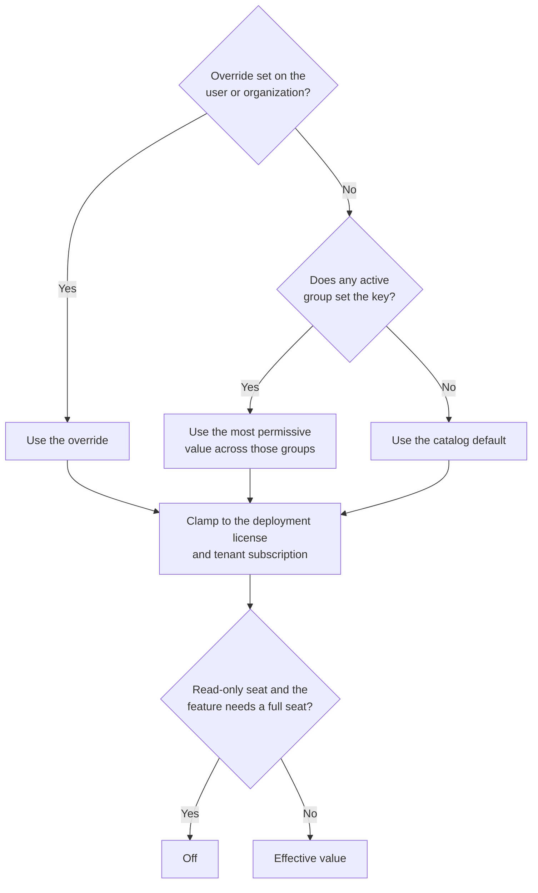

## Overview

Entitlements decide whether a user or organization can use a capability, and how much of it. They are separate from [roles](/pages/admin/user-access#roles): a role controls what someone may do to a resource, while an entitlement controls whether the capability is available at all.

Every entitlement is one of three kinds:

| Kind | Values | Example |
|---|---|---|
| **Feature** | On or Off | `plugin.fea` turns on the FEA simulation plugin |
| **Limit** | A number or Unlimited | `user.projects.max` caps how many projects a user owns |
| **Option** | One value from a ranked list | `llm.profile` selects the user's [LLM profile](/pages/admin/llm-control-plane#profiles-and-routing) |

Entitlements are evaluated on every request, so changes take effect without restarting anything.

### Where To Make A Change

| Goal | Where |
|---|---|
| Change the default for every user | **Groups** → `base` |
| Give a set of users or organizations different values | **Groups** → **New group**, then add each member from their **Entitlements** tab |
| Change one user | **Users** → user → **Entitlements** tab → override |
| Change one organization | **Organizations** → organization → **Entitlements** tab → override |
| Give a time-limited upgrade | User's **Entitlements** tab → **Trial**, or an admin membership with an end date |
| Switch between full and read-only seats | User's **Entitlements** tab → **Seat type** |

## How A Value Is Decided

"Most permissive" depends on the kind of entitlement:

| Kind | Most permissive across groups | License and tenant ceiling |
|---|---|---|
| **Feature** | On if any active group sets On | Off if the license or tenant subscription does not include it |
| **Limit** | The highest number; Unlimited beats every number | The lower of the group value and the ceiling |
| **Option** | The highest-ranked [LLM profile](/pages/admin/llm-control-plane#create-a-profile). Disabled profiles and profiles outside the user's tenant are skipped | None |

Three consequences matter in practice:

- **A group cannot take something away.** If `base` or a plan group turns a feature On, another group setting it Off has no effect. Use an override, or change the group that grants it.
- **An override can lower or raise a value, but never above the license.** An override is the final word among groups and overrides, but the license and tenant subscription still cap it.
- **Some keys follow the organization.** Keys marked *Org decides* in the tables below resolve from the organization when the user works in an organization-owned project, and from the user otherwise.

## Groups

Open **Administration → Groups** (`/admin/~/groups`). The table shows each group's name and key, who it applies to, who manages it, its active member count, and a summary of the values it sets.

### Group Types

| Managed by | Groups | Members added by | Can archive |
|---|---|---|---|
| **System** | `base` | Every user joins automatically when the account is created | No |
| **Billing** | Plan groups such as `core`, `max`, `team`, and `org_owner` | The billing module when a subscription starts or changes. Tenant members join `team` | No |
| **Admin** | Groups you create, such as `pilots` or `power_users` | Administrators, from a user's or organization's **Entitlements** tab | Yes |

You can edit the values of every group, including `base` and plan groups. Billing never overwrites your edits to a plan group.

<Warning>
Editing `base` changes the default for every user in the deployment who does not have a more permissive group or an override.
</Warning>

### Create A Group

1. Select **New group**.
2. Enter a **Key**: lowercase letters, digits, `.`, `_`, or `-`. The key cannot be changed or reused, even after archiving.
3. Enter a **Name** and an optional **Description**.
4. Choose **Applies to**: **Users** or **Organizations**. This cannot be changed later. Organization groups can hold only the keys marked for organizations in the tables below.
5. Select **Create**. The group opens for editing.

### Edit A Group

Select a group row to open it. The editor has three sections, **Limits**, **Options**, and **Features**, and every row shows:

- The key, its description, and its catalog default.
- **Effective Value**: what members receive from this group combined with `base`, labeled **Set on group**, **From base**, or **Catalog default**. Other groups a member belongs to are not included in this preview.
- **Group Setting**: **Catalog default** leaves the key unset in this group. For limits, choose **Custom limit** and enter a number, or choose **Unlimited**. For features, choose **On** or **Off**.

Select **Save group** to apply the changes. Archiving an admin group stops all of its memberships from counting.

### Memberships

Members are added from the member's own page rather than from the group: open a user or organization, go to its **Entitlements** tab, choose the group, optionally set an end date, and select **Add admin membership**. The group's **Members** section lists everyone in it.

A subject can belong to the same group through several sources at once. Each source is added and removed independently, so removing an admin grant does not remove a billing membership in the same group.

| Source | Added when | Ends when |
|---|---|---|
| **Default group** | The account is created (`base`) | Never |
| **Billing plan** | A subscription starts or changes | The billing provider reports the subscription ended |
| **Admin grant** | An administrator adds it | An administrator removes it, its end date passes, or the user subscribes to or cancels a plan |
| **Trial** | An administrator grants a trial | The trial's end date passes, or an administrator revokes it |
| **Tenant membership** | The user joins a tenant (`team`) | The user leaves the tenant |

Davinci warns users before trials and timed admin grants end.

## What You Can Set

The tables below list every key that a group or override can set. The **Notes** column uses these labels:

- **Users**, **Orgs**, or **Both**: which kind of group or override can set the key.
- **Licensed**: also requires the deployment license or tenant subscription to include it.
- **Full seat**: always Off for read-only seats.
- **Org decides**: resolves from the organization in organization-owned projects.
- **Self-service**: users can opt in from their own settings when no group or override sets the key.

### Limits

| Key | Controls | Default | Notes |
|---|---|---|---|
| `user.projects.max` | Projects a user owns | Unlimited | Users |
| `user.orgs.max` | Standalone organizations a user owns | Unlimited | Users |
| `project.collaborators.max` | Collaborators per project | Unlimited | Both · Org decides |

### Options

| Key | Controls | Default | Notes |
|---|---|---|---|
| `llm.profile` | The user's LLM profile | `default` | Users |

### Product Features

| Key | Controls | Default | Notes |
|---|---|---|---|
| `plugin.cad.basic` | Basic 3D CAD modeling and viewing | On | Both · Full seat · Org decides |
| `plugin.cad.advanced` | Advanced CAD modeling and assemblies | On | Both · Licensed · Full seat · Org decides |
| `plugin.ecad.basic` | Basic schematic capture and PCB layout | On | Both · Full seat · Org decides |
| `plugin.ecad.advanced` | Advanced multi-layer PCB routing and analysis | On | Both · Licensed · Full seat · Org decides |
| `plugin.fea` | FEA simulation plugin | On | Both · Licensed · Full seat · Org decides |
| `integration.onshape` | Onshape integration | On | Users · Licensed · Full seat |
| `integration.matlab` | MATLAB and Simulink execution | On | Both · Licensed · Full seat · Org decides |
| `integration.mcp` | Model Context Protocol connections | On | Users · Full seat |
| `bridge.access` | Local desktop bridge relay | On | Users · Full seat |
| `runner.gpu` | GPU-accelerated runner execution | On | Both · Licensed · Full seat · Org decides |
| `runner.remotePools` | Remote execution runner pools | On | Orgs · Licensed · Full seat |

### Access And Security Features

| Key | Controls | Default | Notes |
|---|---|---|---|
| `auth.mfa` | Multi-factor authentication (TOTP) | On | Users |
| `auth.apiKeys` | Programmatic API keys | On | Users · Full seat |
| `auth.personalAccessTokens` | [Personal access tokens](/pages/api/personal-access-tokens) for CLI and API access | On | Users · Full seat |
| `auth.serviceAccounts` | Automated service accounts | On | Users · Licensed · Full seat |
| `org.customRoles` | Custom role definitions in organizations | On | Orgs · Licensed · Full seat |
| `org.groups` | Admin-managed access groups in organizations | On | Orgs · Licensed · Full seat |
| `audit.log` | Audit log recording and viewing | On | Orgs · Licensed |
| `audit.export` | Audit log export and streaming | On | Orgs · Licensed |

The per-user `auth.personalAccessTokens` value does not override the deployment-wide **Enable API Keys** switch in [System Settings](/pages/admin/system-settings-authentication). Both must allow access.

### AI And Usage Features

| Key | Controls | Default | Notes |
|---|---|---|---|
| `ai.byoKeys` | Bring-your-own LLM provider API keys | On | Both · Full seat · Org decides |
| `ai.orgKeys` | Organization-supplied LLM provider keys; also turns on `usage.orgFunding` | On | Orgs |
| `ai.privateProviders` | Private or self-hosted LLM endpoints | On | Orgs · Licensed · Full seat |
| `ai.governance` | AI model governance and policy controls | On | Orgs · Licensed |
| `usage.orgFunding` | Organization-funded AI usage in organization projects | On | Orgs |
| `usage.tracking` | Metering and usage analytics | On | Both · Org decides |
| `usage.budgets` | Spend budgets and on-demand limits | On | Both · Org decides |

### Ownership Features

| Key | Controls | Default | Notes |
|---|---|---|---|
| `user.orgs.own` | Own standalone organizations | On | Users · Full seat |
| `user.orgs.create` | Create standalone organizations without a purchase | On | Users · Full seat |
| `user.tenants.create` | Create a tenant without a purchase | Off | Users · Full seat |

### Rollout Features

Rollout features are temporary switches for features that are still being released.

| Key | Controls | Default | Notes |
|---|---|---|---|
| `rollout.scratchPad` | Scratch Pad workspace panel | Off | Users · Self-service |
| `rollout.journeys` | Journeys object type | Off | Users · Self-service |
| `rollout.cadObjects` | CAD objects in the project tree | Off | Users · Self-service |
| `rollout.webSearchDefault` | Web search on by default for agent runs | Off | Users · Full seat · Self-service |
| `rollout.gitSync` | Git Sync section in the Git view | Off | Users |
| `rollout.simulation.classB` | Class B simulation solver | On | Both · Full seat · Org decides |
| `rollout.simulation.optics` | Optics simulation | On | Both · Full seat · Org decides |
| `rollout.simulation.system` | System simulation (multibody dynamics) | On | Both · Full seat · Org decides |
| `rollout.simulation.geometryAxes` | Simulation geometry axes visualization | Off | Both · Full seat · Org decides |

When no group or override sets a rollout feature, the user's own setting decides. Without one, the deployment's feature flag in [System Settings](/pages/admin/system-settings-authentication) decides, and then the catalog default. Users can change their own setting only for self-service features. Users who connect Onshape also get `rollout.cadObjects`.

### License-Only Keys

Some keys come only from the deployment license or tenant subscription and cannot be set by groups or overrides. They appear as **License only** on the **Entitlements** tab:

- Seat caps (`deployment.seats.full.max`, `deployment.seats.readonly.max`), organization caps (`deployment.orgs.max`, `tenant.orgs.max`), and runner caps.
- Sign-in methods (`auth.sso`, `auth.ldap`, `auth.oauth`, `auth.scim`).
- Deployment capabilities such as cloud storage, multi-replica high availability, offline licensing, and shared included usage.

To change a tenant's seat or organization caps, edit its [tenant subscription](/pages/admin/resources-and-tenants#4-subscription).

## The Entitlements Tab

Each user and organization has an **Entitlements** tab in its detail view. It lists every limit, option, and feature with its effective value and the source that decided it:

| Source | Meaning |
|---|---|
| **Catalog default** | No group or override sets the key |
| **Group:** *name* | The named group supplied the winning value |
| **Override** | A per-subject override set on this tab |
| **Platform** (*reason*) | The license, tenant subscription, or seat changed the value |

When the source is **Platform**, the reason explains why:

| Reason | Meaning |
|---|---|
| not licensed | The license or tenant subscription does not include the feature |
| not installed | The service behind the feature, such as CAD, ECAD, or FEA, is not part of this deployment |
| read-only seat | The feature needs a full seat. When the license is expired or invalid, every user shows this reason |
| license ceiling | The license or tenant subscription capped the limit |

### Overrides

Use the **Override** control on any row that is not **License only**:

- **Limits:** enter a number, or leave the field empty for Unlimited.
- **Features:** choose **On** or **Off**.
- **Options:** choose an LLM profile.

Select **Clear** to remove an override and return the key to its group or catalog value. Every override change is recorded in the audit log.

### Seats

Every active user holds a **Full** or **Read-only** seat. Read-only seats can view, download, export, comment, and use Task Cards, but cannot edit, use the AI agent, or run jobs, even on projects they own.

Seats count against the license and tenant seat caps. Moving a user into a seat type that is at capacity fails; moving a user out of a seat type always succeeds. When the license is expired or invalid, every user's effective seat becomes read-only until the license is fixed, while their stored seat type is kept.

### Trials

Grant a user a trial of any user group by choosing the group, a duration from 1 to 365 days (14 by default), and an optional one-time credit balance in USD. When the trial ends, the user falls back to their plan or `base`, and keeps any unspent trial balance. Select **Revoke trial** to end an active trial early.

Tenant trials are managed on the [tenant's subscription](/pages/admin/resources-and-tenants#4-subscription).

## Common Tasks

| Task | Steps |
|---|---|
| Give pilot users FEA | Create a user group `pilots`, set `plugin.fea` to **On**, then add an admin membership with an end date to each pilot. The license must include FEA |
| Turn a feature off for everyone | Set it **Off** in `base` and make sure no plan or admin group sets it **On**. For one user, use an override instead |
| Give a team a stronger LLM profile | Create a user group, set `llm.profile` to the profile, and add the members. Give that profile a higher rank than the `base` profile |
| Cap projects for free users | Set `user.projects.max` in `base`, and set a higher value or **Unlimited** in the plan groups |
| Find out why a user lacks a feature | Open the user's **Entitlements** tab and read the **Source** column |

## Troubleshooting

| Symptom | Likely cause | Fix |
|---|---|---|
| A feature is On in a group but Off for the user | A **Platform** reason: not licensed, not installed, or read-only seat | Read the reason on the **Entitlements** tab |
| A group sets a feature Off, but the user still has it | Another group, often `base` or a plan group, sets it On | Override it on the user, or change the other group |
| An admin grant disappeared | The user subscribed to or canceled a plan, which clears admin grants | Add the admin membership again |
| A group's LLM profile is not applied | Another group grants a higher-ranked profile, or the profile is disabled or outside the user's tenant | Check profile ranks and status in the [LLM Control Plane](/pages/admin/llm-control-plane#create-a-profile), or override `llm.profile` on the user |
| A user cannot be moved to a full seat | The license or tenant full-seat cap is reached | Free a seat, or raise the cap in the license or tenant subscription |
