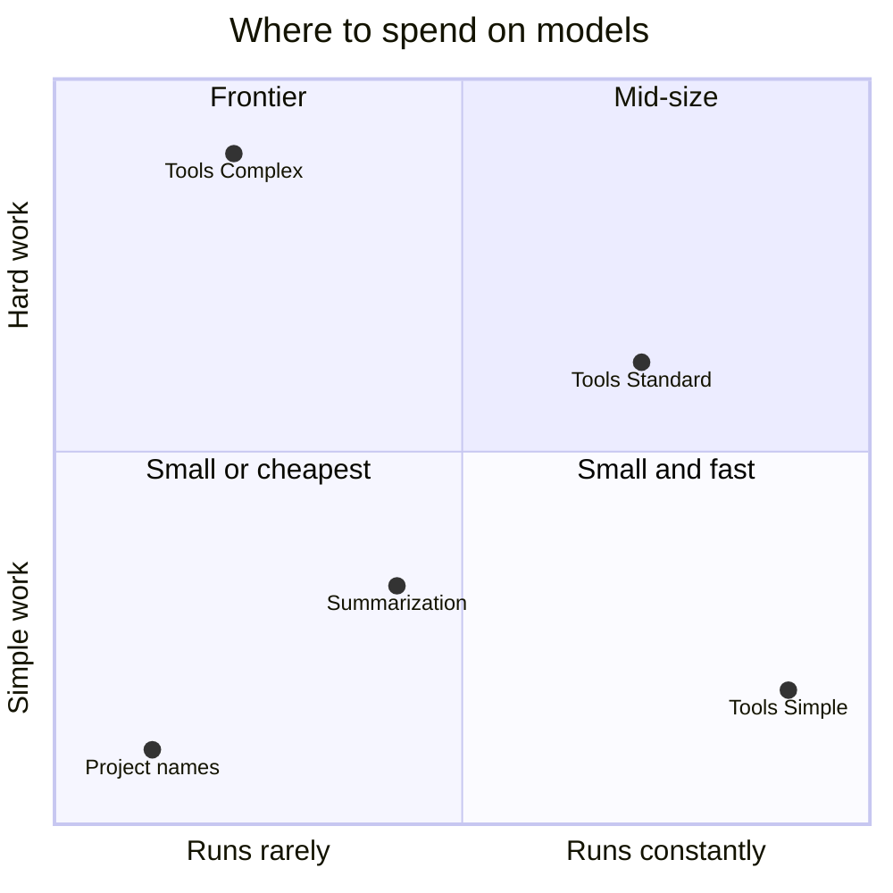

## Overview

A [profile](/pages/admin/llm-control-plane#profiles-and-routing) sends each kind of AI work to its own route. Davinci decides which route a request uses; you decide which model sits on each route.

Matching the class of model to the route matters more than any other setting for quality and cost. A frontier model on the Simple tool route spends heavily on work that runs constantly. A small model on the Complex tool route produces code and CAD that does not compile.

## Routes At A Glance

| Route | What runs on it | Model class | The editor requires | How often it runs |
|---|---|---|---|---|
| **Chat** | The agent conversation users see and steer | Any: frontier, mid-size, or small. Users choose from the models you offer | A general model. Image input strongly preferred | Every user message |
| **Tools: Simple** | Chat titles, skill and context selection, reference lookups, SysML import mapping, property extraction, model review participants | Small | Tools capability | Constantly, often several calls per message |
| **Tools: Standard** | Most tool work: diagrams, slides, state machines, constraints, attribute and task fixes, table extraction, equation review, trade studies | Mid-size | Tools capability | Most tool calls |
| **Tools: Complex** | Code generation, CAD and FeatureScript authoring, schematic and PCB layout authoring, custom toolbox generation, system programs | Frontier | Tools capability | Less often, but the output must compile and run |
| **Summarization** | Compacting long agent conversations so they fit the context window | Small or mid-size with a long context window | Nothing. When empty, the chat model is used | Long conversations |
| **Project names** | Automatic project titles | Small | A general model | Once per project |
| **Reference analysis** | Reading uploaded PDFs and images: OCR, figure and table descriptions, filtering out unhelpful images, images from saved web pages | Low-cost multimodal | Image input | Every upload; a large PDF can produce many calls |
| **Media analysis** | Audio and video tools: transcripts, timestamped summaries, video analysis | Multimodal with native audio and video input | Audio or video input, on a Google provider | When users analyze media |
| **Image generation** | Generated images, presentation backgrounds, SVG and GIF output | Image model | Image output and image pricing | On request |
| **Embedding** | Vector search over project content and references | Embedding model | Embedding model kind and input-only pricing | Indexing and every search |

For the routes where the choice is a trade between cost and quality, plot how hard the work is against how often it runs:

Chat is not plotted because users choose from every class. Reference analysis, Media analysis, Image generation, and Embedding are not plotted because the input or output type decides the model.

Users pick their chat model from the choices the profile offers, so offer several across price points: a frontier model for hard problems, a mid-size model for everyday work, and a small model for quick questions. Davinci works with text-only chat models, but strongly prefer models with image input so the agent can see images in the conversation. The agent also calls tools from chat, so choose models with reliable tool calling and streaming even though the editor does not require them.

<Note>
**Media analysis runs only on a Google provider.** Davinci uploads the file to the Gemini File API, so the provider must authenticate with an API key or environment variable. Media analysis on any other provider fails at runtime. Uploaded media leaves your deployment for Google's service.
</Note>

## Example Models

Hosted models are listed by family, without version numbers. Providers release new versions often, so use the newest version of each family and confirm the exact model ID in the provider's model list.

The open-source column lists US open-weight models only. They run through an [OpenAI-compatible, Ollama, LiteLLM, Groq, Cerebras, or OpenRouter provider](/pages/admin/llm-provider-configuration#supported-provider-recipes). Every chat and tool model in the tables accepts image input except gpt-oss, which is marked *text only*.

### Text And Tool Routes

| Route | Open source (US) | Google | OpenAI | Anthropic |
|---|---|---|---|---|
| **Chat** | Muse Spark Open, Gemma 4 31B, Gemma 4 26B A4B, Llama 4 Maverick, gpt-oss-120b (*text only*) | Gemini Carbon, Gemini Argon, Gemini Hydrogen, Gemini Flash | GPT Astra, GPT Sol, GPT Terra, GPT Luna | Claude Opus, Claude Sonnet, Claude Haiku |
| **Tools: Simple** | gpt-oss-20b (*text only*), Gemma 4 12B, Gemma 4 E4B | Gemini Flash-Lite, Gemini Flash | GPT Luna | Claude Haiku |
| **Tools: Standard** | Gemma 4 31B, Gemma 4 26B A4B, gpt-oss-120b (*text only*), Llama 4 Maverick | Gemini Argon, Gemini Hydrogen, Gemini Flash | GPT Sol, GPT Terra | Claude Sonnet, Claude Haiku |
| **Tools: Complex** | Muse Spark Open, gpt-oss-120b (*text only*), Llama 4 Maverick | Gemini Carbon, Gemini Argon | GPT Astra, GPT Sol | Claude Opus, Claude Sonnet |
| **Summarization** | gpt-oss-120b (*text only*), Gemma 4 26B A4B, Llama 4 Scout | Gemini Flash, Gemini Flash-Lite | GPT Luna, GPT Terra | Claude Haiku |
| **Project names** | gpt-oss-20b (*text only*), Gemma 4 E4B, Gemma 4 E2B | Gemini Flash-Lite | GPT Luna | Claude Haiku |

Muse Spark Open is Meta's frontier open-weight model: 816B total parameters with 42B active per token and a 1M-token context window. Self-hosting it takes a multi-GPU server, so most deployments use it through a hosted platform such as Groq or OpenRouter. Its license has limited commercial terms. Other open-weight models trail hosted frontier models on the Complex route, so pair a self-hosted deployment with a hosted model there when policy allows.

### Multimodal And Specialized Routes

| Route | Open source (US) | Google | OpenAI | Anthropic |
|---|---|---|---|---|
| **Reference analysis** | Gemma 4 31B, Gemma 4 26B A4B, Gemma 4 12B, Llama 4 Scout, Muse Spark Open | Gemini Flash, Gemini Flash-Lite | GPT Luna, GPT Terra | Claude Haiku, Claude Sonnet |
| **Media analysis** | Not supported | Gemini Flash, Gemini Flash-Lite, Gemini Hydrogen | Not supported | Not supported |
| **Image generation** | None recommended | Nano Banana 2.1 (`gemini-nano-banana-2.1`), Nano Banana 2 Lite (`gemini-3.1-flash-lite-image`) | GPT Image (`gpt-image-2.6-flare`, `gpt-image-2.6-sunburst`, `gpt-image-2`) | Not offered |
| **Embedding** | EmbeddingGemma, nomic-embed-text, Snowflake Arctic Embed | Gemini Embedding 2 (`gemini-embedding-2`) | `text-embedding-3-small`, `text-embedding-3-large` | Not offered |

### Embedding Dimensions

The embedding offering's vector dimensions must match the model's output. Changing dimensions after vectors exist requires regenerating project vectors.

| Model | Default dimensions | Shorter sizes |
|---|---|---|
| `text-embedding-3-small` | 1536 | Supported |
| `text-embedding-3-large` | 3072 | Supported |
| `gemini-embedding-2` | 3072 | 128 to 3072; 768 and 1536 recommended |
| EmbeddingGemma | 768 | 512, 256, 128 |
| nomic-embed-text | 768 | Supported |
| Snowflake Arctic Embed L 2.0 | 1024 | 256 |

## Tips For Choosing

- **Chat:** offer three or four models across classes, preferably with image input, and mark the one most users should use day to day as the default. Put the most expensive frontier models in a higher profile when cost matters.
- **Open-weight tool calling:** the serving stack must expose tool calling. For example, start vLLM with automatic tool choice and the model's tool parser, or use an Ollama model that lists tool support. Confirm with [verification](/pages/admin/llm-control-plane#verification) before publishing.
- **Reasoning models:** they add latency to every call. On the Simple route, prefer a non-reasoning model or set a low reasoning effort in the route's generation defaults.
- **Context windows:** Summarization and Reference analysis read long inputs. Pick models with large context windows for both.

## Single-Vendor And Self-Hosted Setups

| Setup | Covers | Gaps |
|---|---|---|
| **Google only** | Every route | None |
| **OpenAI only** | Every route except Media analysis | Add a Google provider for Media analysis, or leave that route empty |
| **Anthropic only** (direct, Bedrock, or Vertex) | Chat, all tool routes, Summarization, Project names, Reference analysis | No Image generation, Embedding, or Media analysis. Add OpenAI or Google for those routes |
| **Self-hosted open-weight** | Chat, all tool routes, Summarization, Project names, Reference analysis with a vision model, Embedding | No Media analysis, and no recommended US open-weight image model. Add a hosted provider for those routes |

A profile can be published with only a default chat route and the three tool routes. Users of that profile cannot use any workload whose route is left empty, except Summarization, which falls back to the chat model.
