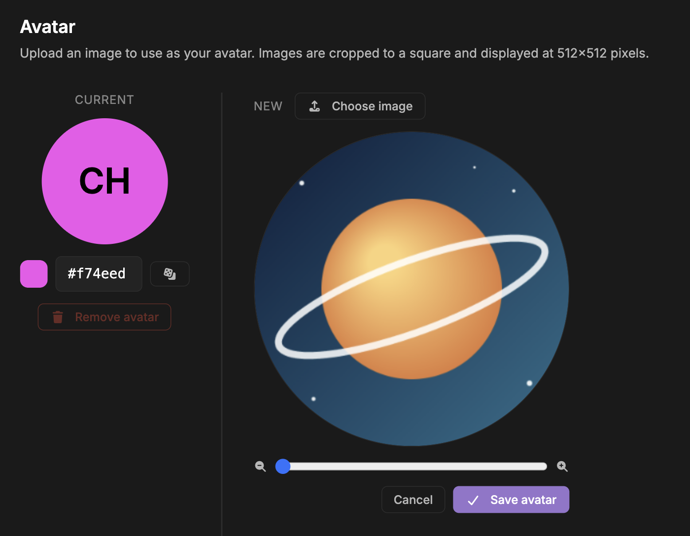
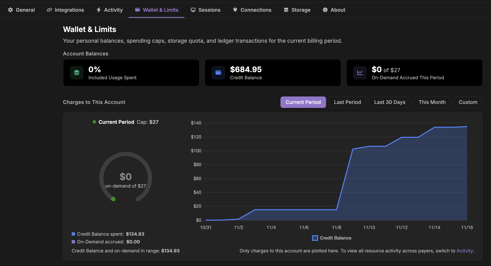

## Overview

Every Davinci user has an account. Your account controls your identity in the Davinci app, your personal projects, your profile, your security settings, and your personal access tokens.

Account management is separate from organization or group management. A user account can own projects directly, belong to organizations, and belong to a group.

## How To Get There

Open account settings from your avatar menu in the Davinci Browser or go to `/~/settings`.

You can also click your avatar in the Davinci Editor and select **Settings**. This takes you back to account settings in the Browser.

Settings are organized into tabs, including **General**, **Activity**, **Wallet & Limits**, **Plan & Invoices**, **Sessions**, **Connections**, **Storage**, and **About**. Some tabs, such as **Integrations** and **Plan & Invoices**, appear only when the feature is available in your deployment.

## General

The General tab covers your profile, security, and preferences.

### Account

- **Name** — your display name, shown across Davinci and on your public profile. Click the pencil icon to edit it.
- **Avatar** — your avatar image and color. Click `Edit` to open the Avatar page (`/~/settings/avatar`). See [Avatar](#avatar).
- **Email** — the email address tied to your account. This is read-only and cannot be changed from this page.
- **License Key** — a unique identifier for your account. It is hidden by default; click the eye icon to reveal it. Support may ask for this when helping with your account.
- **Password** — click `Change Password` to update your password. This option is only shown if you signed up with email (not available for Google or SSO sign-in).
- **Sign Out** — log out of Davinci on this browser.

### Avatar

The Avatar page shows your **Current** avatar next to an editor for a **New** image.

- **Color** — sets the background color of your avatar bubble. Pick a color with the color picker, type a hex value (for example, `#3b82f6`), or click the dice button to choose a random color. Color changes save immediately.
- **Image** — click `Choose image` to upload an image, then drag to position it and use the zoom slider to crop it. Click `Save avatar` to apply it. Images are cropped to a square and displayed at 512×512 pixels.
- **Remove avatar** — removes your uploaded image so your avatar shows your initials on your chosen color again.

<Frame>
    
</Frame>

### Handle

Your handle is your public identifier on the platform (e.g. `@yourname.celedon.io`). It appears in your profile URL and anywhere your username is shown.

**Changing your handle:**
1. Click the pencil icon next to your current handle.
2. In the dialog, edit the username portion. Your handle will be `{username}.celedon.io`.
3. Click `Save`.

Handles must be unique across the platform.

**Custom Domain Handle (paid plans only):**

Paid users can verify a domain they own and use it as their handle instead of the default `.celedon.io` format. For example, you could use `@alice.example.com` instead of `@alice.celedon.io`.

<Steps>
    <Step title="Start verification">
        Click `Use Custom Domain` in the Handle section. A verification dialog will open.
    </Step>
    <Step title="Enter your domain">
        Type the domain you want to use (e.g. `example.com`) and click `Continue`.
    </Step>
    <Step title="Prove ownership">
        Davinci will provide verification instructions. You can choose between two methods:

        **DNS Record** — add a TXT record to your domain's DNS with the provided Name/Host and Value. Set the TTL to 3600.

        **HTTPS File** — create a file at a specific URL on your domain with the exact content provided.

        Copy the values using the copy buttons and add them through your domain registrar or hosting provider.
    </Step>
    <Step title="Verify">
        Click `Verify`. Davinci will check for your DNS record or HTTPS file. Once found, your domain is verified and your handle is updated immediately.
    </Step>
</Steps>

If you want to revert to the default `.celedon.io` handle after verifying a custom domain, click `Revert to Default` in the Handle section.

### Notifications

Control which emails you receive from Davinci:
- **Email notifications** — toggle on or off to receive emails for invitations, alerts, and activity updates.
- **Marketing emails** — toggle on or off to receive product updates and news from Celedon Solutions.

### Security

If your deployment has two-factor authentication (2FA) enabled, this section appears with options to:
- **Enable 2FA** — choose between an **Authenticator App** (TOTP) or **Email Code** method. For authenticator apps, scan the QR code and enter the verification code to activate.
- **Disable 2FA** — enter a verification code to turn off two-factor authentication.

### Danger Zone

- **Delete Account** — permanently delete your account and all associated data. You must type `DELETE` to confirm. This action cannot be undone.

<Warning>Deleting your account removes all projects you own and revokes access to shared projects. Export any important data before proceeding.</Warning>

## Activity, Wallet & Limits, And Plan & Invoices

Usage and billing are split across three tabs. For detailed usage, plan, storage, organization, and group billing concepts, see [Usage, Plans, And Billing](/pages/browser/usage-plans-billing/overview).

### Activity

The Activity tab (`/~/settings/activity`) shows the AI, embedding, and tool usage across your projects, broken down by who funded it: you, an organization, or your group.

### Wallet & Limits

The Wallet & Limits tab (`/~/settings/limits`) shows your balances and spending caps for the current billing period:
- **Account Balances** — your Included Usage, Credit Balance, and on-demand usage accrued this period. If you are in a group, this section also shows the group's shared funding.
- **Charges to This Account** — a chart of charges to your own balances for the current period, last period, or a custom range.
- **On-Demand Usage Limit** — the most on-demand usage you can accrue per period after Included Usage and Credit Balance run out. Choose **Off**, a preset amount, **Unlimited**, or **Custom**. You can change this limit on a paid plan. Group members' limits are managed by the group administrator.
- **Storage Quota** — your storage usage against your limit.
- **Account Ledger** — every charge, credit, period reset, and limit change recorded on your account.

<Frame>
    
</Frame>

### Plan & Invoices

The Plan & Invoices tab (`/~/settings/invoices`) appears when self-service billing is available for your deployment:
- **Subscription** — your plan, billing frequency, price, and renewal or cancellation date, with **Cancel at Period End** or **Resume**.
- **Billing Portal** — click `Manage` to open the Stripe customer portal for payment methods, billing details, and receipts.
- **Plan** — your current tier, with **Upgrade** or **Change Plan** links to the [Upgrade page](https://davinci-app.com/~/upgrade).
- **Group Plan** — if you are on a group plan, links to the Group page and shows **Leave Group** or **Disband Group**; otherwise, a link to upgrade to a Group plan.
- **Owned Organizations** — organizations you own, with links to each organization's billing.
- **Invoices** — subscription and on-demand usage invoices, with status, amount, and a **Receipt** link. See [How On-Demand Usage Is Billed](/pages/browser/usage-plans-billing/overview#how-on-demand-usage-is-billed).

## Connections

The Connections tab is where you manage integrations and API access for your account.

Personal access tokens identify your user account and inherit your project access. Store them securely and revoke exposed tokens.

See [Personal Access Tokens](/pages/api/personal-access-tokens) for API token details.

## Storage

The Storage tab gives you an overview of how much storage you are using.

- **Summary** — a line showing your total usage relative to your plan's storage limit.
- **Project breakdown** — a sortable table listing each project's uploaded file size, project name, last accessed date, and project ID. Sort by any column to find your largest files.

Storage limits depend on your plan, organization, group, and deployment. See [Usage, Plans, And Billing](/pages/browser/usage-plans-billing/overview) for storage and usage concepts.

## About

The About tab provides quick links and a way to send feedback.

- **Send Feedback** — type a message and click `Send` to share feedback with the Davinci team.
- **Links** — direct links to the Terms of Service, Privacy Policy, Celedon Solutions website, and Davinci documentation.
