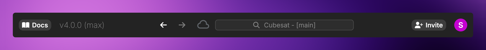

The Editor is Davinci's full-featured design workspace. It loads when you click `Open Project` from a Project Page on the Davinci Browser, and runs at `/app/{owner}/{project}/{branch}`.

## Panels and widgets

The Editor has a [Left Panel](/pages/editor/panels/left-panel) and [Right Panel](/pages/editor/panels/right-panel) around the central workspace. Both panels contain [movable widgets](/pages/editor/widgets/overview). Project Settings and Scratchpad remain utility launchers at the bottom of the Left Panel's widget rail.

## Header Bar

The Header Bar runs across the top of the Editor and provides several tools:

<Frame>
     
</Frame>

### Navigation Buttons
Home returns to the Davinci Browser. The back and forward arrows near the search bar move through views you have visited within the Editor. You can also use your browser's built-in back/forward buttons or mouse buttons.

### Connection Indicator
The cloud icon shows your connection status to the Davinci servers:
- A gray cloud means you are connected.
- A red cloud with a slash means you are disconnected.

### Search Bar
Click the search box to open a search menu. Type to search your model for objects by Name or Short Name. Click a result to open it in the workspace. For more advanced queries, use [Search](/pages/editor/widgets/search).

<Note>The Search Bar is only enabled when a project is loaded.</Note>

### Account Menu
Click your avatar in the top right to open a dropdown menu:
- **Profile** — view your public profile on the Davinci Browser
- **Settings** — navigate to Account Settings on the Davinci Browser (`/~/settings`)
- **Log out** — sign out of Davinci

## Model Area

The Model Area is the primary workspace and is covered in detail on its own page.

<Card title="Model Area" horizontal icon="link" href="/pages/editor/model-area">
  Read more about the Model Area
</Card>

Key sections of the Model Area:
- **Left Panel** — the widget rail and selected panel content
- **Workspace** — tabbed view where you open, view, and edit objects
- **Right Panel** — a resizable panel for the active workspace
- **Bottom Bar** — workspace switcher, branch and validation status, focused-object context, and panel controls

## Bottom Bar

The Bottom Bar runs across the bottom of the Editor and is split into left and right regions:

### Left Side (Workspace, Branch & Validation Status)
- **Connection Status** — appears when saving, syncing, or reconnecting, with hover details for the last sync time or active server commit/update status.
- **Workspaces** — create a new workspace (`+`), browse workspace history, switch between active or pinned [workspaces](/pages/editor/agent/workspaces), or rename, duplicate, and delete workspaces.
- **Current Branch & Sync** — shows the active Git branch and uncommitted change count badge (clicks to open [Source Control](/pages/editor/widgets/source-control)), plus a quick **Sync Changes** button.
- **Validation Summary** — live counts for Errors, TBDs, Inconsistencies, Stale values, and objects needing Review (clicks to open [Validation](/pages/editor/widgets/validation)).

### Right Side (Focused Tab Context & Panel Controls)
- **Focused Object Context** — dynamically updates for the active workspace tab:
  - **Document tabs**: word count (`N Words`) and current page (`Page X / Y`).
  - **Code, Toolbox & Simulation Setup tabs**: cursor line/column (`Ln X, Col Y`) and language (`Python`, `C++`, `JavaScript`, `TypeScript`).
  - **Review Status**: the focused object's current review state (**Needs Review**, **Reviewed**, **Needs Re-review**, or **Review Not Required**), which clicks directly to the object's [Review](/pages/user-guide/views/review) view.
  - **Object Type**: the icon and type name of the focused model object.
- **Model Statistics** — total object count and hierarchy depth (`N Objects, M Depth`), which clicks to open **Project Settings → Summary**.
- **Project Memory** — opens the Project Memory graph in a workspace tab.
- **Left & Right Panel Toggles** — collapse or restore the Left Panel (`Cmd/Ctrl + Shift + I`) and Right Panel (`Cmd/Ctrl + Shift + P`).

## Project Settings

The Project Settings area in the Editor provides access to in-project configuration that is specific to the model. This is different from the project-level settings on the Davinci Browser (rename, visibility, collaborators, delete).

Editor Project Settings includes:
- [Summary](/pages/editor/project-settings/project) — model statistics, health indicators, and export
- [Files](/pages/editor/project-settings/files) — manage uploaded files and storage
- [Toolboxes](/pages/editor/project-settings/toolboxes) — configure available toolboxes
- [Unit Settings](/pages/editor/project-settings/unit-settings) — custom unit definitions
- [Schema](/pages/editor/project-settings/relationship-settings) — project subclasses and relationship type configuration
- [Secrets](/pages/editor/project-settings/secrets) — project secrets for scripts and integrations
- [Dependencies](/pages/editor/project-settings/dependencies) — package dependencies
- [Tags](/pages/editor/project-settings/tags) — tag management
- [Risk](/pages/editor/project-settings/risk) — risk category configuration
- [Persona Settings](/pages/editor/project-settings/persona-settings) — agent persona configuration
- [MCP](/pages/editor/project-settings/mcp) — Model Context Protocol settings
