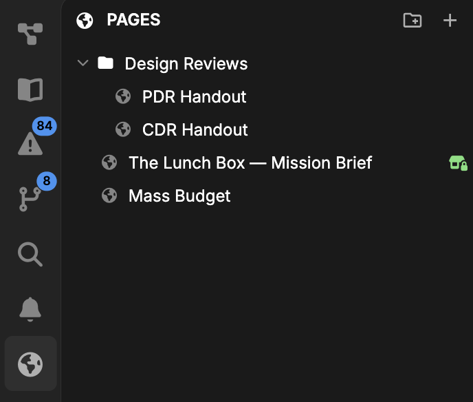
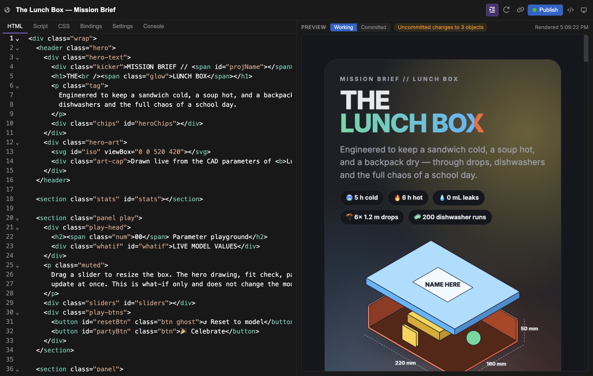
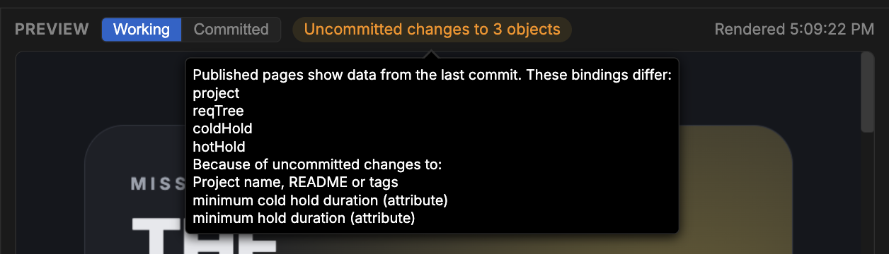
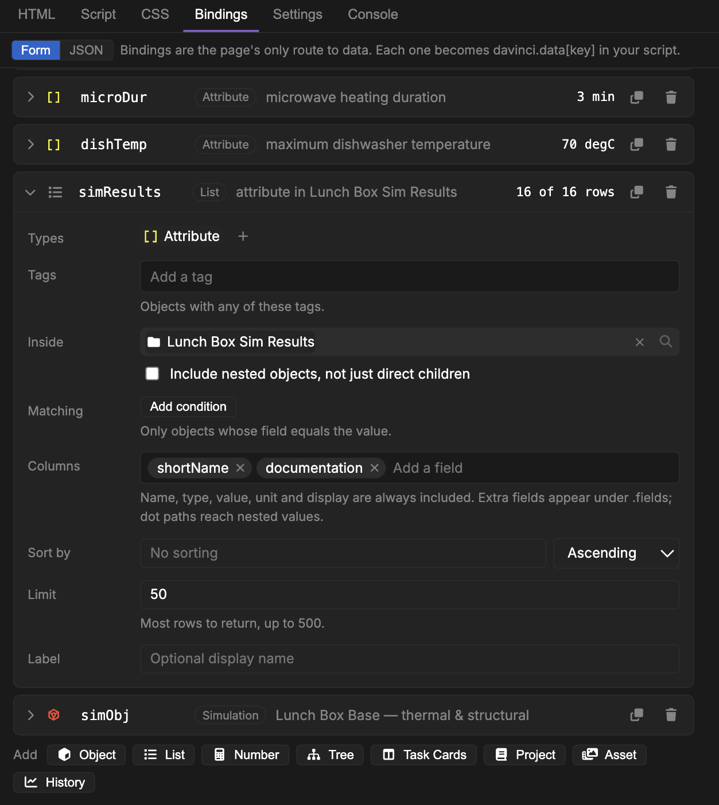
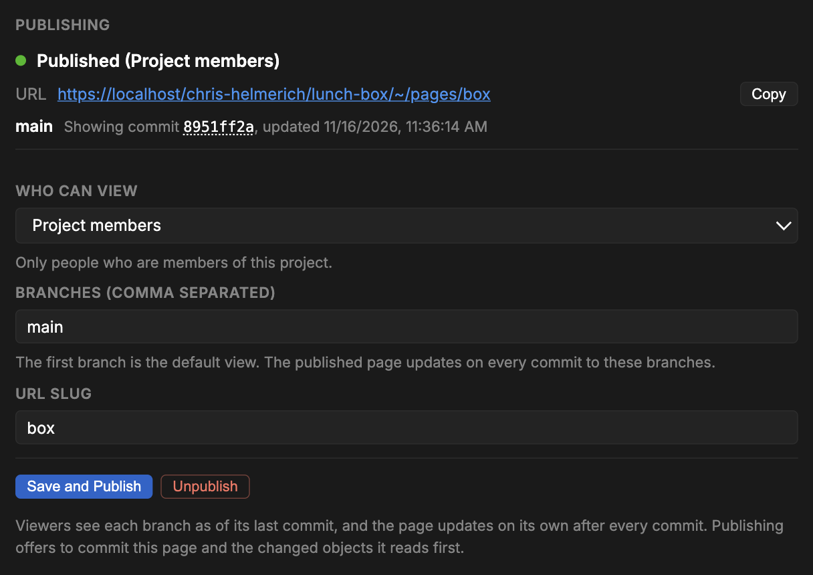
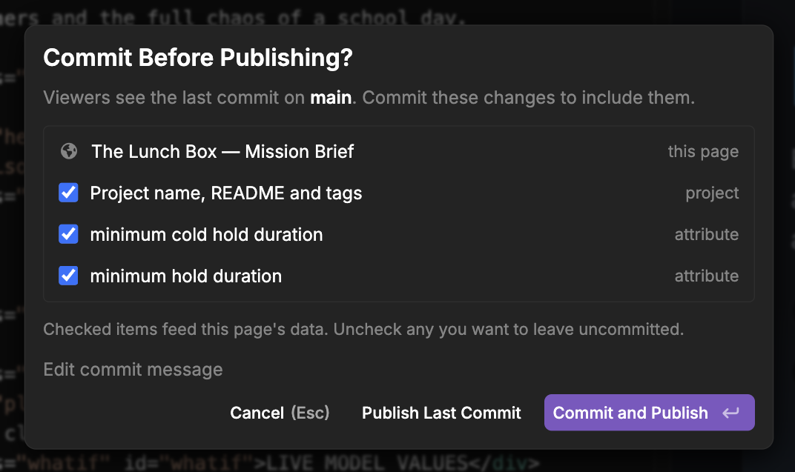
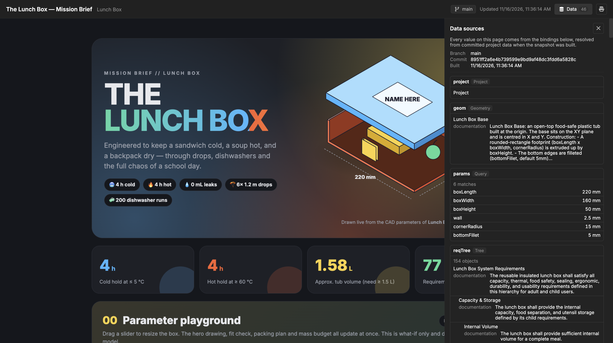

## Overview

A page is a report or dashboard you write in HTML, JavaScript, and CSS. A page does not store model values itself. It reads them through **bindings**: each binding names model data, such as one object's value, a filtered list of objects, a sum over matching objects, or an object's value at every commit, and the page script renders whatever the bindings return. When the model changes, the page shows the new values.

Typical uses include:

- Mass, power, or cost budgets with margins and charts.
- Requirement or verification status summaries.
- Trend charts of a key value across the project's commits.
- Design review handouts that combine model values, images from references, and Task Card status.

Pages are stored with the project, so they are versioned with branches and committed like any other change. You can [publish](#publishing-and-sharing) a page so people can open it in a browser without opening the Editor.

## Opening The Pages Panel

Pages are listed in the **Pages** widget, which is in the [Left Panel](/pages/editor/panels/left-panel) widget rail by default (globe icon). Like other widgets, it can be moved to the [Right Panel](/pages/editor/panels/right-panel).

<Frame>
    
</Frame>

Click a page to open it in a workspace tab. A published page shows a badge after its name; hover over the badge to see who can view it and which branches it serves.

## Creating And Organizing Pages

To create a page:

1. Open the **Pages** widget.
2. Click **Add Page** (`+`). If a folder is selected, the page is created inside it.
3. The new page, named **New Page**, opens in the page editor with a starter layout and script.
4. Click the name at the top of the editor to rename it.

Use **Add Folder** to group pages. Drag pages and folders to reorder them or move them into a folder. Right-click a page or folder to open, rename, move, or delete it. Deleting a folder moves its contents up one level.

Anyone who can edit the project can create and edit pages. Project members without edit access can open pages and their preview, but the editor is read-only for them.

## The Page Editor

The page editor has a code editor on the left and a live preview on the right. Use the pane toggles in the editor's header to show or hide either side.

<Frame>
    
</Frame>

The code editor has these tabs:

| Tab | Contents |
| --- | --- |
| **HTML** | The page body. Write body content only, without `<html>`, `<head>`, or `<script>` tags. |
| **Script** | JavaScript that runs after the HTML loads. It reads model data through the `davinci` object. |
| **CSS** | Plain CSS for the page. |
| **Bindings** | The data the page reads. See [Binding Model Data](#binding-model-data). |
| **Settings** | The page description, [libraries](#libraries), and [publishing](#publishing-and-sharing) settings. |
| **Console** | Output from the page's `console` calls, script errors with line numbers, and binding problems. |

Edits save automatically, and collaborators editing the same page see each other's changes. If a source is over its [size limit](#limits-and-sandboxing), the header shows **Not saved** and the problem is listed under the code editor.

The **Bindings** tab shows a count when bindings have errors, and the **Console** tab shows a count of script errors.

### Formatting

The format toggle in the editor header (**Code: auto format on**) formats the HTML, Script, and CSS tabs when you leave the editor: two-space indentation, single quotes, and lines up to 100 characters. The agent uses the same formatting, so your edits and the agent's do not reflow each other. Click the toggle to turn it off.

### Preview

The preview re-renders as you type and whenever the model changes. Click **Reload preview** to restart the page from scratch. The preview follows the Editor's light or dark theme.

The preview header has two modes:

- **Working** shows live data from your workspace, including uncommitted changes.
- **Committed** shows data at the last commit on the current branch, which is what a published page shows.

When a binding's value differs between the two, a chip such as **Uncommitted changes to 3 objects** appears in the preview header. Hover over it to see which bindings differ and which uncommitted objects cause the difference.

<Frame>
    
</Frame>

## Binding Model Data

Bindings are the page's only route to project data. Each binding has a key, and its value is available in the page script as `davinci.data.<key>`.

The **Bindings** tab has two views:

- **Form** lists each binding as a card. Click a card to edit it, or use the **Add** buttons to add a binding of each kind. Drag objects from the Model tree onto the bindings list to bind them; a dropped reference with an uploaded file becomes an **Asset** binding, and a dropped part studio or assembly becomes a **3D** binding. Each card shows a preview of its current value or its error.
- **JSON** shows the same bindings as raw JSON.

<Frame>
    
</Frame>

### Binding Kinds

| Kind | Returns |
| --- | --- |
| **Object** | One object's name, type, value, unit, and display text, plus any extra fields you list. |
| **List** | Rows of objects matching types, tags, a parent, and field conditions, with optional sorting and a row limit. |
| **Number** | A count, sum, average, minimum, or maximum over matching objects. |
| **Tree** | An object and its children, nested up to a chosen depth. |
| **Task Cards** | Task Cards filtered by status, tag, or linked object. |
| **Project** | The project's name, README, and tags. |
| **Asset** | The uploaded file of a reference object, such as an image, video, or 3D model file. |
| **3D** | A part studio or assembly's 3D model, as built at the page's source. See [Showing 3D Models](#showing-3d-models). |
| **History** | One object's value at each commit that changed it. |

Selection options for **List** and **Number** bindings:

- **Types**: only objects of these types. Leave empty for any type.
- **Tags**: objects with any of these tags.
- **Inside**: only children of this object. Turn on **Include nested objects** to include all descendants, not just direct children.
- **Matching**: only objects whose field equals the given value.

For **Object**, **List**, and **Tree** bindings, name, type, value, unit, and display are always included. Add field names under **Fields** (or **Columns** for a List) to include more. Dot paths such as `resolvedValues.mass` reach nested fields. A value field of `value` means the object's resolved value, as calculated in the model.

A **Number** binding combines values without unit conversion. If the matching objects use different units, the binding reports a mixed-units warning.

**Task Cards** bindings always read the project's current cards. They are not versioned with commits, and a card can link to different objects on each branch.

Every binding can have a **Label**, which the page and the published view's data panel show instead of the key.

### Pinned Commits

By default, bindings read the branch the page is viewed on. To compare against a fixed point in history, open the **Pinned commits** section of the Bindings form, click **Pin a Commit**, and enter a commit SHA from [Source Control](/pages/editor/widgets/source-control#graph) and a label such as "Baseline". Then choose that commit under **Read from** on any binding except Task Cards.

A pinned commit never changes, so a binding that reads it always shows the same values. Bindings cannot read another branch live.

### Using Bindings In The Script

The page script reads data through the `davinci` object. Register a render function with both `davinci.ready` and `davinci.onUpdate`, and make it redraw from scratch each time:

```js
davinci.ready(render);
davinci.onUpdate(render);

function render(davinci) {
  const total = davinci.entries.totalMass;
  document.getElementById('mass').textContent = total.error
    ? 'Unavailable'
    : davinci.format.value(total.value);
}
```

| Name | Use |
| --- | --- |
| `davinci.ready(fn)` | Runs `fn` once, when data first arrives. |
| `davinci.onUpdate(fn)` | Runs `fn` every time the data refreshes. |
| `davinci.data[key]` | The value of a binding. |
| `davinci.entries[key]` | The binding with its `kind`, `label`, `value`, and `error`. Check `error` and show a placeholder when it is set. |
| `davinci.meta` | The page name, project name, branch, commit, build time, and `objectLinks`, which says whether [object links](#opening-objects-in-the-editor) work. |
| `davinci.format` | Formatting helpers: `value`, `number`, `percent`, `delta`, and `date`. Each returns an em dash for missing values. |
| `davinci.asset(key)` | Loads the file of an **Asset** binding. See [Showing Files From References](#showing-files-from-references). |
| `davinci.geometry(key)` | Loads the meshes of a **3D** binding. See [Showing 3D Models](#showing-3d-models). |
| `davinci.openObjects(ids)` | Opens objects or Task Cards in the editor from a click. See [Opening Objects In The Editor](#opening-objects-in-the-editor). |
| `davinci.objectUrl(ids)` | The editor URL that opens those objects, as text, or `null` when object links are off. |

To match the viewer's light or dark theme, use the CSS variables `--page-bg`, `--page-surface`, `--page-border`, `--page-text`, `--page-muted`, `--page-accent`, `--page-good`, `--page-warn`, and `--page-bad` instead of fixed colors.

<Tip>Bind values instead of typing them into the HTML or script. A typed number goes out of date as soon as the model changes; a bound one does not.</Tip>

### Showing Files From References

An **Asset** binding shows the uploaded file of a [reference object](/pages/editor/files-and-references#reference-objects), such as a diagram, photo, video, audio clip, PDF, or CSV. Choose the reference, or drag it from the Model tree, then load the file in the script:

```js
davinci.asset('diagram')
  .then((file) => {
    document.getElementById('diagram').src = file.url;
  })
  .catch(() => {
    document.getElementById('diagram').alt = 'Diagram unavailable';
  });
```

The result's `url` works as the source of an ``, `<video>`, or `<audio>` element, and its `blob` can be read as text or bytes, for example to parse a CSV. A page cannot offer the file for download or embed it in a frame.

Asset bindings have these limits:

- Images and other files up to 25 MB, audio and 3D model files up to 100 MB, and video up to 250 MB.
- The reference must belong to this project. References from an included project cannot be shown.
- A file uploaded before file versioning was introduced cannot be shown. Replace the reference's file to use it on a page.

A published page shows the file version in the branch's last commit. If you replace the reference's file, the published page shows the new file after the change is committed.

### Showing 3D Models

A page can show an orbitable 3D model of a part studio or assembly built in this project, or of an uploaded 3D model file:

1. Turn on the **three.js** [library](#libraries) in the **Settings** tab.
2. Add a **3D** binding and choose the part studio or assembly, or drag it from the Model tree. For an uploaded file, use an **Asset** binding on its reference instead.
3. In the script, create a viewer once and load the model into it on every render:

```js
const box = document.getElementById('model');
const viewer = DavinciViewer.create(box, { height: '420px', spin: true });

async function render() {
  const entry = davinci.entries.bracket;
  if (entry.error) {
    box.textContent = entry.error;
    return;
  }
  try {
    await viewer.load(await davinci.geometry('bracket'));
  } catch (error) {
    box.textContent = error.message;
  }
}

davinci.ready(render);
davinci.onUpdate(render);
```

Viewers drag to orbit, scroll to zoom, and right-drag to pan. `viewer.load` also accepts `await davinci.asset(key)` for an **Asset** binding whose file is a GLB or glTF, STL, OBJ, 3MF, or PLY model. A glTF file must be a single `.glb` or self-contained `.gltf` without mesh compression.

| Viewer option or method | Use |
| --- | --- |
| `DavinciViewer.create(element, options)` | Adds the viewer to `element`. Options include `height`, `edges` (outline edges, on by default), `background` (`'theme'` or a color), `spin`, `spinSeconds`, and `spinToggle`. |
| `viewer.load(model, { view })` | Shows the model, replacing the previous one, and fits the camera. `view` is a preset view such as `'iso'`. |
| `viewer.fit()`, `viewer.setView(name)` | Fits the camera, or turns it to a preset view: `iso`, `front`, `back`, `left`, `right`, `top`, or `bottom`. |
| `viewer.highlight(ids)` | Highlights parts by object id. |
| `viewer.onPick(fn)`, `viewer.onHover(fn)` | Calls `fn` with the part's object id, instance, name, face, point, and normal when the viewer clicks or hovers over it. |
| `viewer.setSpin(on)`, `viewer.isSpinning()`, `viewer.onSpinChange(fn)` | Controls spin from the page's own buttons or checkboxes. |

With `spin: true` the model turns slowly about its vertical axis, like the 3D view's Idle Spin. It starts 5 seconds after the model loads or the viewer last interacted, pauses while they hold the mouse down, and turns once a minute; `spinSeconds` sets the period from 5 to 120 seconds. Spin also adds a **Spin** toggle to the viewer's corner so viewers can stop it. Pass `spinToggle: false` to hide the toggle.

A **3D** binding shows the model as it was last built at the page's source. Pages never start a build:

- In the editor, the binding reports **Not built yet** until the part studio or assembly is built at its current state. Open it in the 3D view to build it.
- A published page reports **Not built for this commit** until that committed state has been built. Build the part after your last edit and before committing it. The published page updates on its own once the build exists.
- An Onshape part must have a synced version.
- Circuits, other object types, and parts from included projects cannot be shown.

Materials used by the model are applied from their current color and finish, so material edits show without rebuilding the part.

<Warning>Anyone who can view the page can download the meshes of its 3D models, because the browser receives them to draw the model. Check before binding confidential CAD to a public or secret-link page.</Warning>

### Opening Objects In The Editor

A page can link to model objects and Task Cards so that clicking the link opens them as tabs in the Davinci editor, on the branch the page shows, with the first one focused. Add the object ids to any element with `data-davinci-objects`:

```html
<button data-davinci-objects="<object id>,<object id>">Open in editor</button>
```

In the script, `davinci.openObjects(ids)` does the same from a click handler, and `davinci.objectUrl(ids)` returns the editor URL as text. Ids are object UUIDs, or `card-<uuid>` for Task Cards, up to 20 per link.

- In the page editor preview, the objects open in the current editor.
- On a published page, the objects open in an editor already showing that project and branch, or in a new tab. Viewers need access to the project to see them.
- Links open only when the viewer clicks, at most once a second.
- Object links are off on [secret-link](#secret-links) pages, because the editor URL would reveal the project. There, link elements are dimmed with a tooltip explaining why, and `davinci.meta.objectLinks.url` is `null`.

### Charting A Value Over Time

A **History** binding returns one object's value at each commit that changed it, oldest first, for trend charts such as mass margin over the life of the project. Each point has the commit, its time and message, and the value as it was calculated when that commit was made.

- **Field** defaults to `value`, the object's resolved value. Other fields use dot paths.
- **Points** keeps the most recent changes: 50 by default, up to 200.
- History reads commits only, so uncommitted edits appear after the next commit. An object that has never been committed returns an error.

## Libraries

Turn on a library under **Libraries** in the **Settings** tab to use it in the page script:

| Library | Global | Use for |
| --- | --- | --- |
| **Chart.js** | `Chart` | Line, bar, pie, scatter, and radar charts. |
| **Plotly** | `Plotly` | Interactive scientific plots, 3D surfaces, and heatmaps. |
| **D3** | `d3` | Custom data-driven SVG and layouts. |
| **KaTeX** | `katex` | Math typesetting with `katex.render`. |
| **three.js** | `THREE`, `DavinciViewer` | 3D models and scenes. `DavinciViewer` shows [3D bindings and model files](#showing-3d-models); `THREE.addons` has OrbitControls and the GLTF, STL, OBJ, 3MF, and PLY loaders. |

Enabled libraries load before the page script. Other libraries cannot be loaded.

## Limits And Sandboxing

Pages run in an isolated frame, both in the editor preview and when published. In practice this means:

- A page cannot make network requests or load anything from outside Davinci: no `fetch`, external scripts, stylesheets, images, or fonts. Use bindings for data, **Asset** and **3D** bindings for files and models, and the [built-in libraries](#libraries) for charts, math, and 3D. Inline `data:` images are allowed.
- A page cannot reach the Davinci app, open popups or new windows, submit forms, embed frames, or navigate away. The one exception is [object links](#opening-objects-in-the-editor), which ask Davinci to open objects in the editor after a click.
- `localStorage`, `sessionStorage`, and cookies work only in memory and are cleared whenever the page reloads.

Bindings and sources have size limits:

| Limit | Value |
| --- | --- |
| HTML, Script, and CSS | 100,000 characters each, unless the project sets another limit in [Project Settings > Pages](/pages/editor/project-settings/pages) |
| Bindings JSON | 32,768 characters |
| Bindings per page | 100 |
| Pinned commits per page | 8 |
| Rows per List or Task Cards binding | 500 |
| Fields per binding | 40 |
| Tree depth | 8 levels (2,000 objects) |
| History points | 200 |

A binding whose result is too large returns an error asking you to narrow its selection, fields, or limit. Fields that hold secrets and other sensitive project settings are never available to a page.

## Versioning And Branches

Pages are part of the project, so every page edit is an uncommitted change on the current branch:

- Page changes appear under **Pages** in the [Source Control](/pages/editor/widgets/source-control#changes) **Changes** list. Opening one shows a diff of each changed part: name, description, libraries, HTML, script, CSS, and bindings.
- Commit page changes like any other change. Commit details also list changed pages.
- Each branch has its own version of every page. Creating a branch copies the pages, and merging brings page changes across.
- If a merge changes the same part of a page on both branches, the page is marked as conflicted in the **Pages** widget. Open it to see each conflicting part as a diff, choose **Accept Current** or **Accept Incoming** for each, then complete the resolution and commit it.

<Note>A published page shows each branch as of its last commit. Uncommitted page edits and uncommitted model changes are not visible to viewers until they are committed.</Note>

## Publishing And Sharing

Publishing makes a page viewable in a browser at its own URL, outside the Editor. Publishing settings belong to the page, not to a branch, and you choose which branches the published page serves.

### Who Can Publish

Publishing, changing sharing settings, rotating secret links, and unpublishing require the **Publish Pages** permission. By default, project Owners and Admins have it; Editors and Viewers do not. See [Roles And Permissions](/pages/browser/roles-permissions). Without it, the **Publish** button is disabled and the publishing settings are read-only.

### Publishing A Page

<Steps>
  <Step title="Open the publishing settings">
    Click **Publish** in the page editor header. The first time, this opens **Publishing** in the **Settings** tab.
  </Step>
  <Step title="Choose who can view">
    Pick an option under **Who can view**. See [Who Can View](#who-can-view).
  </Step>
  <Step title="Choose branches">
    Enter one or more branch names under **Branches**, separated by commas. It defaults to the branch you are on.
  </Step>
  <Step title="Set the URL slug">
    Optionally enter a **URL slug**. If you leave it empty, Davinci derives one from the page name.
  </Step>
  <Step title="Publish">
    Click **Publish**. If the page or the objects it reads have uncommitted changes on the current branch, Davinci asks whether to commit them first.
  </Step>
</Steps>

<Frame>
    
</Frame>

The **Commit Before Publishing?** dialog lists what the published page would be missing: this page's own changes, and any uncommitted objects (and project name, README, or tags) that its bindings read. Uncheck any objects you want to leave uncommitted. Then choose:

- **Commit and Publish** commits this page and the checked items, then publishes. Other pages and other uncommitted work stay uncommitted. Click **Edit commit message** to change the default message, `Publish page "<name>"`.
- **Publish Last Commit** publishes without committing. Your uncommitted changes are not included.
- **Cancel** stops without publishing.

<Frame>
    
</Frame>

If you cannot commit on the project, the page is published as of the last commit.

After the first publish, the **Publish** button reuses the saved settings. To change them, edit the Publishing section and click **Save and Publish**.

### Who Can View

| Option | Who can open the published page |
| --- | --- |
| **Project members** | Only members of the project. |
| **Project readers** | Anyone who can open the project, including readers of a public project. |
| **Organization** | Members of the organization that owns the project. |
| **Secret link** | Anyone with the link. See [Secret Links](#secret-links). |
| **Public** | Anyone on the internet. |

Only **Public** pages can be indexed by search engines.

Someone who opens a page URL they are not allowed to see gets a "not found" page, so the page's existence is not revealed. Visitors who are not signed in are sent to sign in first.

### Branches

A published page serves up to 10 branches. The first branch listed is the default view. When a page serves more than one branch, viewers can switch branches from a selector in the page header.

If you edit a page on a branch the publication does not serve, the **Publish** button's tooltip says so. Add the branch under **Branches** to serve its version.

When a served branch is deleted, it is removed from the publication. If it was the only branch, the page is unpublished.

### URLs

A published page's URL has this form:

```
https://<your Davinci address>/<owner>/<project>/~/pages/<page-slug>
```

`<owner>` is the handle of the user or organization that owns the project, and `<project>` is the project's slug. A slug uses lowercase letters, numbers, and dashes, up to 64 characters, and must be unique within the project. To open a specific branch, add `?branch=<branch name>`.

The Publishing section shows the URL with a **Copy** button, and the link icon next to **Publish** copies it.

### Secret Links

With **Secret link** visibility, Davinci creates a link of the form `https://<your Davinci address>/pages/<token>`. Anyone with it can view the page without signing in.

<Warning>The secret link is shown only once, right after it is created. Copy it then. Davinci does not keep a readable copy, so it cannot show the link again.</Warning>

To revoke access, click **Rotate Link** in the Publishing section. The old link stops working immediately, and a new link is shown once. A secret-link view opens the default branch and does not show a branch selector, a link to the project, or working [object links](#opening-objects-in-the-editor).

Switching to another visibility option deletes the secret link.

### What Viewers See

The published page opens with a header showing the page name and project, the branch, and when the page was last updated. The header also has:

- **Data**: a panel listing every binding with the objects and values it resolved to, the branch, the commit, and any pinned commits.
- **Print**: prints the page.
- **Out of date**: shown when the branch has commits newer than the page's last update.

If a binding could not be resolved, the page shows whatever its script renders for an error, usually a placeholder, and the **Data** panel marks the binding as unresolved. The detailed problem messages are shown only to editors, in the Publishing section.

If the page has not been built on a branch yet, for example because the page does not exist in that branch's last commit, viewers see a message that the page appears after it is committed to that branch.

<Frame>
    
</Frame>

### Keeping A Published Page Current

A published page updates on its own after every commit, merge, or rollback on a branch it serves. It shows that branch's last commit: both the committed version of the page and the committed model data. You do not need to publish again after each commit.

The Publishing section shows the state of each served branch, such as **Showing commit** with a link to the commit, **Updating to the latest commit**, or **Update failed**. It also lists any bindings that could not be resolved at that commit. If an update failed, click **Retry Update**.

The **Publish** button reads **Published** when the published page is up to date. When it reads **Publish**, its tooltip lists what has changed, such as uncommitted page edits or a served branch that is behind its latest commit.

### Unpublishing

To stop sharing a page, click **Unpublish** in the Publishing section. The published view and its link stop working, and its stored update history is deleted. The page stays in the project.

<Note>Deleting a page does not unpublish it. Once the deletion is committed, viewers of that branch no longer see the page, but the publication remains. Unpublish the page first to remove it completely.</Note>

## Pages And The Agent

The [Davinci Agent](/pages/editor/agent/agent-tools#pages) can create pages, edit their HTML, script, CSS, and bindings, change their settings, and render them to check the layout, script errors, and binding problems before reporting back. Its edits appear in the open page editor as they happen.

- The agent publishes a page only when your current request asks it to publish or share the page. Before publishing, it checks for uncommitted changes the page depends on and asks whether to commit them.
- Publishing through the agent needs the same **Publish Pages** permission as publishing yourself.
- The agent cannot create or rotate secret links. Use the page editor's Publishing settings for those.
- You can @-mention a page in an agent chat message, and pages the agent mentions appear as links that open the page.
- When a **3D** binding it is working on reports **Not built yet**, the agent builds the part studio or assembly, then checks the page again.
