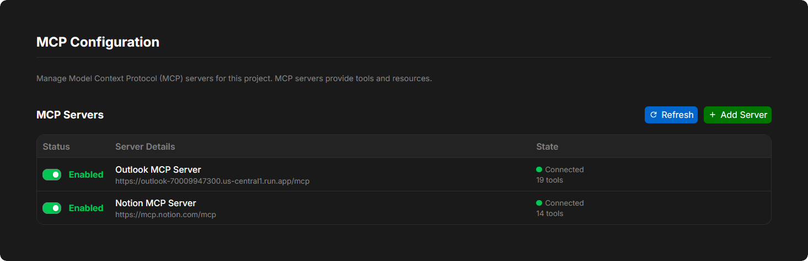

The **MCP Servers** tab in Project Settings allows you to connect external Model Context Protocol (MCP) servers to your project, extending the Davinci Agent's capabilities with specialized tools, data sources, and external integrations.

<Frame>
     
</Frame>

## What Is MCP?

**Model Context Protocol (MCP)** is an open standard that enables AI agents to connect to external servers that provide tools, resources, and domain-specific actions. In Davinci, MCP servers let the agent query external databases, issue trackers, documentation systems, CAD/PLM services, and custom internal APIs.

MCP servers are stored outside Git version control, so enabling a server, updating credentials, or adding a project server applies across the project without dirtying your working tree or creating merge conflicts.

<Info>
For organization-wide and system-wide MCP server registration, policy controls, and managing your saved credentials from the Davinci Browser (`/~/settings/integrations`), see [Integrations Overview](/pages/integrations/overview).
</Info>

## Approved Servers Vs. Project Servers

The project MCP tab separates servers into two sections:

- **Approved servers**: Provided by your organization, tenant, or system administrators. Project managers (`project:mcp:manage`) can toggle an approved server **On** or **Off** for the project without re-entering its endpoint configuration.
- **Project servers**: Custom MCP servers added directly to this project. If your organization or system administrator has turned off **Allow project-defined servers** in [MCP policy](/pages/integrations/overview#mcp-policy-controls), the **Add Server** button is hidden and the project can only use **Approved servers**.

## Enabling And Configuring A Server In A Project

Each server row displays its name, scope badge (**System**, **Tenant**, **Organization**, or **Project**), URL, authentication method, live connection status, and an **On / Off** toggle.

When a server is toggled **On** for the project, two per-project options appear on the row:

- **Connect automatically**: Automatically connects to the server a few seconds after the project opens in the Editor (servers that require interactive user sign-in wait until you sign in once).
- **Share files**: Allows the Davinci Agent to send project files to this server using temporary one-time links that expire after one hour. This toggle is only available when both the organization/system policy (**Allow MCP file sharing**) and the server definition allow file sharing.

## Connecting And Authenticating

Depending on how the server's authentication is configured, the server row displays the action needed to connect:

- **No authentication / Shared credential**: Turning the server **On** connects automatically, or you can click **Connect**.
- **Per-user API key, Bearer token, or Basic auth (`Needs your key`)**: Click **Add key** to open **Your credential for `<Server Name>`**, enter your personal **Token**, **API key**, or **Username** and **Password**, and click **Save**.
- **Interactive OAuth (`Sign-in required`)**: Click **Sign in** to open the identity provider in a popup window and authorize access.

Once connected, the status indicator shows a green dot with the number of loaded tools (for example, `Connected · 5 tools`). Click the status text to inspect the exact tool names and statuses loaded by the Design Engine.

To remove your saved personal sign-in or key for a server, click the remove (`×`) button on the server row, or manage all of your saved MCP credentials from your [Integrations page](/pages/integrations/overview#managing-credentials-in-account-settings-davinci-browser) (`/~/settings/integrations`).

## Adding Or Editing A Project MCP Server

When **Allow project-defined servers** is enabled and you have permission to manage project MCP servers (`project:mcp:manage`), click **Add Server** under **Project servers**:

1. **Name & Server URL**: Enter a display name (for example, `Company Docs`) and the MCP server endpoint URL (for example, `https://mcp.example.com/mcp`).
2. **Description**: Optional summary of what the server provides.
3. **Transport**: Select **Streamable HTTP** or **Server-Sent Events (legacy)**.
4. **Authentication**:
   - **No authentication**
   - **OAuth (automatic client registration)** or **OAuth (your own client ID)** — displays the **Redirect URI** to register with your identity provider.
   - **OAuth machine-to-machine** — uses a **Client ID**, **Client secret**, **Expected issuer**, and optional **Scopes**.
   - **Bearer token**, **API key header** (with custom **Header name**, default `X-API-Key`), or **Username and password** — choose **One shared credential for everyone** or **Each user enters their own**.
5. **Project Options**: Choose whether to enable **Connect automatically** and **Allow file sharing**.
6. **Test Connection & Save**: Click **Test connection** to verify connectivity and preview the server's tools before saving, then click **Add** (or **Save**).

To edit or remove a project-scoped server, use the **Edit server** (pencil) or **Delete server** (trash) icons on the server row. Organization-scoped servers display an external link icon that opens the organization's MCP settings page (`/{org-handle}/~/settings#mcp-servers`) for authorized organization admins.
