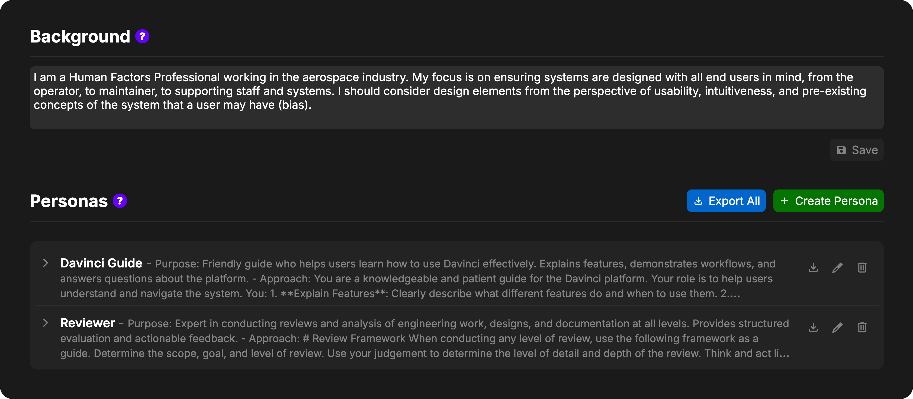

The Persona Settings view allows you to manage your personas and set your user background for the project.

[Learn More About Personas & Backgrounds](/pages/editor/agent/persona)

<Frame>
     
</Frame>

## User Background

User Background allows you to specify your role, discipline, and perspective within the project. This helps the agent understand what angle you're approaching the work from and what aspects you're likely to care about.

### Setting Your Background

The Background section appears at the top of the Persona Settings page. Enter information about your position, expertise, and focus areas in the text field. For example:

- "Mechanical Engineer focused on thermal analysis and structural design"
- "Systems Engineer responsible for requirements management and verification"
- "Project Manager overseeing schedule, budget, and stakeholder communication"
- "Electrical Engineer specializing in power systems and circuit design"

**To save your background:**
1. Type or edit the text in the Background text field
2. Click the **Save** button to save your changes

<Note>
User Background is stored per-user, per-project. Each user can set their own background for each project they work on.
</Note>

## Default persona for new chats

The Default Persona section, under Background, chooses the persona a new chat starts with. Chats you have already started keep the persona they were using.

Davinci checks three places, in order:

1. **My Default**, if you have set one and that persona still exists
2. **Project Default**, if a project owner or admin has set one and that persona still exists
3. **Standard Persona**, the built-in persona

Choose **Project Default** in My Default to follow the project. Choose **Standard Persona** there when you want the built-in persona even if the project default is something else.

Project owners and admins set the project default. Editors can set their own default and can see the project default, but cannot change it. If the persona you chose is later removed, new chats use the Standard Persona.

These defaults are saved with the project, but they are not part of the project file and are not tracked by version control. They apply to every branch. A branch that does not contain the chosen persona uses the Standard Persona until that persona exists on the branch.

## Personas

The Personas section displays all available personas for the current project. The Standard Persona is listed first. It is built in, so it cannot be edited, exported, or deleted.

### Creating a New Persona

To create a new persona, click the **Create Persona** button in the header.

A new persona form will appear at the top of the list with three fields:

- **Name**: A label for identifying the persona (visible to you but not sent to the agent)
- **Purpose**: Describes the overall goal or what the agent should be trying to accomplish
- **Approach**: Specific instructions for how the agent should execute tasks

Fill in the fields and click **Save** to create the persona, or **Cancel** to discard it.

### Viewing Persona Details

Personas are displayed as collapsible rows. Each row shows:

- The persona name in bold
- A preview of the purpose and approach

**To expand a persona:**
- Click anywhere on the persona row
- The chevron will rotate and the full Purpose and Approach text will be displayed

**To collapse a persona:**
- Click the row again
- The chevron will rotate back and the preview will be shown

### Editing a Persona

To edit an existing persona:

1. Hover over the persona row to reveal action buttons
2. Click the edit icon
3. Modify the Name, Purpose, or Approach fields
4. Click **Save** to apply changes or **Cancel** to discard them

### Exporting Personas

Personas can be exported as `.dmo` files and imported into other projects.

**To export a single persona:**
1. Hover over the persona row to reveal action buttons
2. Click the export icon
3. Save the `.dmo` file

**To export all personas:**
1. Click the **Export All** button in the header
2. Save the `.dmo` file containing all personas

<Note>
The "Export All" button is disabled when no personas exist in the project.
</Note>

### Importing Personas

To import a persona from a `.dmo` file:

1. Upload the `.dmo` file directly into the project (drag-and-drop or upload button in the Files tab)
2. Davinci will recognize it as a persona and automatically add it to your persona list

This is useful for reusing effective personas across multiple projects or sharing successful persona configurations with team members.

### Deleting a Persona

To delete a persona:

1. Hover over the persona row to reveal action buttons
2. Click the delete icon
3. The persona will be removed immediately

<Warning>
Deleting a persona is permanent and cannot be undone.
</Warning>

## Version Control and Conflicts

Personas are tracked by Davinci's version control system just like model objects.

- **Branching**: Different branches may have different personas available
- **Conflicts**: If a persona is edited on multiple branches before merging, a conflict will occur
- **Resolution**: When viewing merge conflicts, you must choose which version to keep for each conflicted persona

<Note>
When merge conflicts exist for personas, the "Create Persona" button will be disabled until all conflicts are resolved.
</Note>

## Persona Storage

Personas are stored **per-user, per-project**. This means:

- Each user has their own list of personas
- Personas are unique to each project
- Other users cannot see or use your personas unless you export and share them

