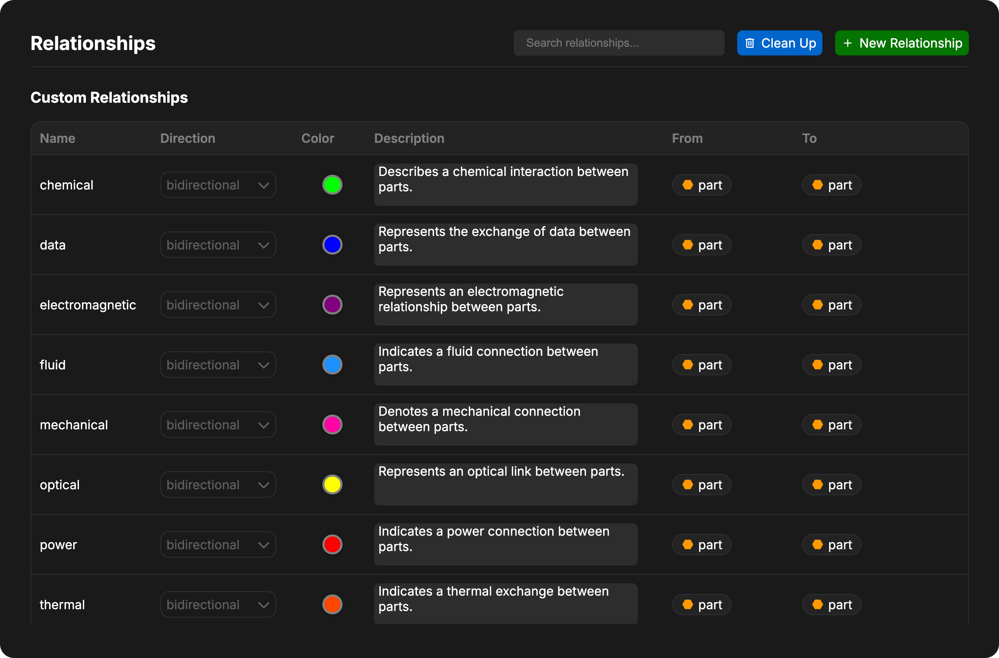

The **Schema** tab in Project Settings lets you customize your project's modeling vocabulary. It combines two sections:

1. **Project Subclasses**: Specialize canonical Davinci object types with custom names, icons, colors, and semantic definitions.
2. **Relationships**: View, search, create, edit, and clean up the relationship types that connect objects in your model, including relationship endpoint rules that target specific subclasses.

<Frame>
     
</Frame>

## Project Subclasses

Project subclasses let you define domain- or framework-specific classifications (such as `Sensor`, `Controller`, or UAF stereotypes like `OperationalPerformer`) on top of Davinci's built-in base object types without changing the underlying model schema.

<Info>
For how subclasses interact with object creation, [Object Inheritance](/pages/modeling/common/inheritance), the Davinci Agent, and SysML exports, see [Project Subclasses](/pages/modeling/common/subclasses).
</Info>

### Searching Subclasses

Use the **Search subclasses...** input in the Project Subclasses header to filter subclasses in real time by name, base object type, or semantic definition text.

### Creating a Project Subclass

To add a new subclass to the project:

1. Click **Add Subclass** in the Project Subclasses header.
2. Configure the subclass in the **Add Project Subclass** dialog:
   - **Name**: A unique name for the subclass (up to 128 characters; cannot contain `.`).
   - **Base Type**: The canonical Davinci object type this subclass specializes (for example, `part`, `entity`, `action`, `requirement`, `port`, or `item`).
   - **Color**: Defaults to the base object type's color, or pick a custom color.
   - **Semantic Definitions**: Optional description (up to 2,000 characters) explaining the meaning and intended usage of the subclass.
3. Click **Create Subclass**.

<Note>
A subclass's **Base Type** is immutable after creation. If you need a classification under a different base type, create a new subclass for that base type.
</Note>

### Editing Subclasses

Each row in the Project Subclasses table lets you update the subclass directly:

- **Rename**: Click the subclass name to edit it inline. Renaming a subclass automatically updates all objects assigned to that subclass (`subclassId`) and all relationship endpoint definitions that reference it.
- **Edit Symbol and Color**: Click the pen icon on the subclass avatar to open the appearance dialog, where you can:
  - Choose a custom color or click **Use base type color** to reset it.
  - Select from built-in Davinci object symbols or paste custom inline SVG markup (sanitized automatically) for the subclass icon.
- **Semantic Definitions**: Click the definition text below the subclass name to edit its description inline.

### Deleting a Subclass

To delete a subclass:

1. Click the trash icon on the right side of the subclass row.
2. Review the confirmation dialog, which reports how many objects and relationship definitions currently reference the subclass.
3. Click **Delete Subclass** to confirm.

When confirmed, Davinci automatically resets any objects using that subclass back to their base object type and reverts any relationship endpoint selectors referencing that subclass back to the base type.

---

## Managing Relationships

The **Relationships** section below Project Subclasses lets you manage all built-in and custom relationship types in your project.

### Searching Relationships

Use the search box in the Relationships header to filter relationship types by name in real time.

### Creating Custom Relationships

To create a new custom relationship:

1. Click the **New Relationship** button in the header.
2. Configure the relationship properties:
   - **Name**: Unique identifier for the relationship (no spaces).
   - **Direction**: Unidirectional or bidirectional.
   - **Color**: Visual color for diagrams and views.
   - **Description**: Purpose and usage of the relationship.
   - **From**: Valid source object types or project subclasses.
   - **To**: Valid target object types or project subclasses.

### Constraining Relationship Endpoints with Subclasses

When configuring **From** and **To** endpoints on a custom relationship, you can select:

- `ALL` (any object type)
- Canonical base object types (such as `part` or `requirement`)
- Specific **Project Subclasses** (displayed as `SubclassName (baseType)` with the subclass's icon and color)

When a relationship endpoint specifies a project subclass, only objects with that effective subclass (either assigned directly or inherited through `extends`) are valid for that endpoint. In the table, you can click `+` to add or edit endpoints, or click `×` on an endpoint bubble to remove it (removing the sole subclass endpoint on a relationship reverts it to its base type).

### Editing Custom Relationships

Custom relationships can be edited directly in the table:

- **Direction**: Click the dropdown to switch between unidirectional and bidirectional.
- **Color**: Click the color box to open the color picker.
- **Description**: Click the description text to edit inline.
- **From / To**: Use the `+` and `×` controls on the endpoint bubbles to update allowed source and target types or subclasses.

<Note>
Only custom relationships can be edited. Base and internal relationships are read-only to maintain SysML v2 compatibility and system integrity.
</Note>

### Deleting Custom Relationships

To delete a custom relationship:

1. Hover over the relationship row.
2. Click the trash icon that appears.
3. Confirm the deletion.

When a relationship type is removed from the project schema, it can no longer be added by users or the Davinci Agent.

<Warning>
Deleting a relationship type from the schema does not automatically remove existing relationship instances from model objects. Use the **Clean Up** button to remove orphaned relationships from objects in the model.
</Warning>

### Cleaning Up Relationships

The **Clean Up** button scans all model objects and removes relationship instances that no longer match valid relationship definitions in the project schema. This is useful when:

- You have deleted a custom relationship type
- Object types or subclass assignments have changed
- Relationship endpoint constraints (`From` / `To`) have been narrowed

<Danger>
The Clean Up action removes all relationships across the model that are not defined in the current schema. Review your schema changes before running Clean Up.
</Danger>

## Relationship Properties

Each relationship type displays the following properties:

- **Name**: The identifier of the relationship.
- **Direction**: Whether the relationship is unidirectional or bidirectional.
- **Color**: The visual color used to represent this relationship in diagrams and views.
- **Description**: A brief explanation of the relationship's purpose.
- **From**: The object types or project subclasses that can be the source of this relationship (displayed as bubbles with icons).
- **To**: The object types or project subclasses that can be the target of this relationship (displayed as bubbles with icons).

<Note>
When a relationship shows `ALL` in the **From** or **To** column, it can connect to any object type.
</Note>

## Relationship Categories

Davinci organizes relationships into three categories:

### Base Relationships (SysML v2)

Standard relationships defined by the SysML v2 specification. These relationships are read-only to ensure your model remains compatible with standard systems engineering practices and can be exported to valid SysML v2 formats.

### Custom Relationships

Project-specific relationships created by users, seeded by a framework (such as UAF), or registered during model import. Custom relationships can be edited or deleted from the Schema tab.

### Internal Relationships

System-managed relationships that Davinci creates automatically to maintain model connectivity and structure. These relationships are read-only:

- `Uses`: Automatically created when an Attribute or Constraint references another object in its equation.
- `Reference`: Links Reference objects to other model elements.

## Additional Resources

For a detailed list of all base relationship types and their definitions, see the [Relationships Documentation](/pages/modeling/common/relationships). For more on using subclasses across your model, see [Project Subclasses](/pages/modeling/common/subclasses).
