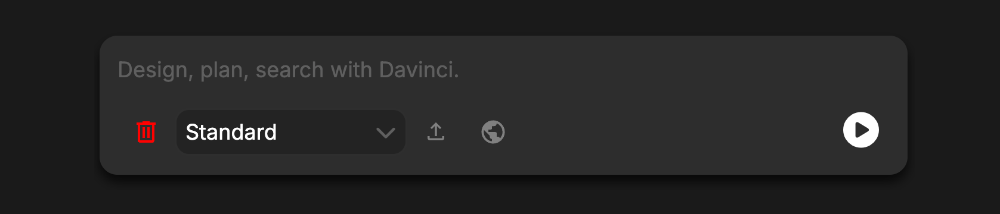
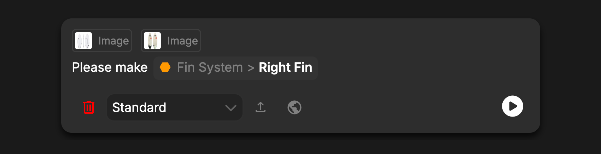
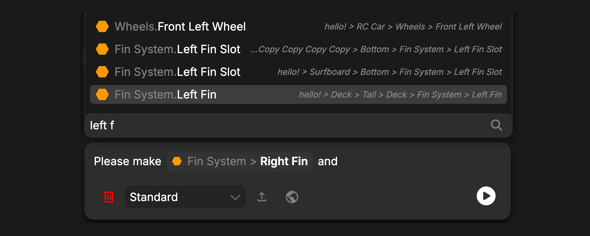
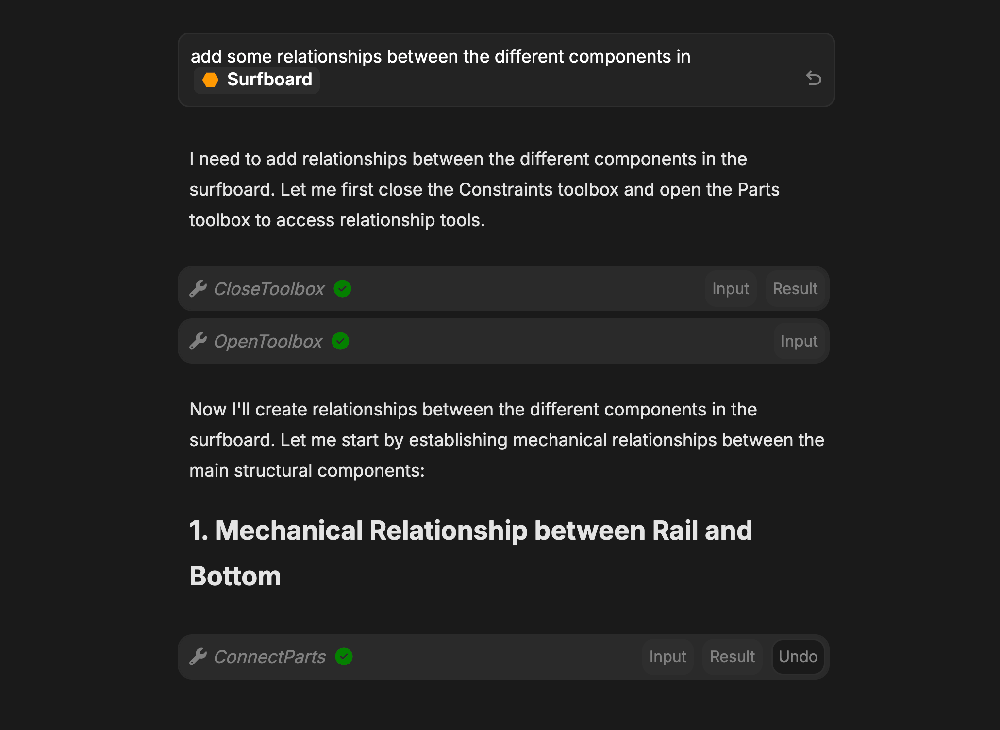
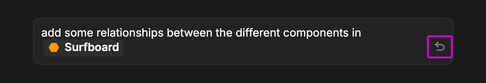
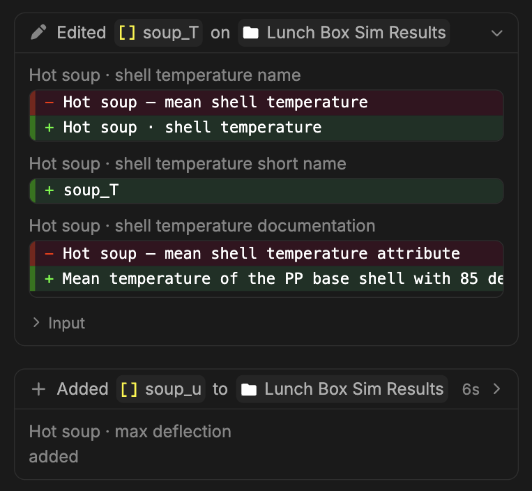

Agent Chat is where interactions with the Davinci Design Agent happen. The Chat has several unique features that allow for seamless interaction between the user and Agent, allowing maximum flexibility during design.

<Note>This is an overview of the agent interface for Davinci. To see how to use Davinci effectively, see the [Agent Guide](/pages/editor/agent/agents)</Note>

## Chat Input

The Davinci Agent chat input area has several key functions to allow users to instruct the Agent. Primarily, users can provide text to Davinci, describing actions they wish to take on the model. It is good to be specific when providing both context and instruction, referencing existing model objects when possible.

<Frame>
    
</Frame>

### Text

Text is the simplest form of input that the Agent can accept. Simply type into the Chat box any instructions and the design agent will respond directly or, for larger work, build an [agent plan](/pages/editor/agent/planning) and execute it as a series of tasks.

### Images

The Chat Input can accept images (png/jpg/webp formats) that are pasted into the chat. These images will be passed to the Agent for extra visual context.

Preview pasted images by hovering your mouse over the image cards.

To remove an image once it is pasted, hover over the image card, then click the "x" to clear it. Up to 10 pasted images can be included for any message.

<Frame>
    
</Frame>

### Model Objects

The Chat Input can accept references to model objects using `@`. Simply type `@` and begin typing the name of the object you would like to use.

Objects can be searched for directly, or via their parent using a `.` `parent.object` if you have many objects with similar names. Press tab to autocomplete the current name, and enter to accept.

This will add the Model Object as context for the Agent, so it knows exactly what Objects are important.

<Frame>
    
</Frame>

### Chat Input Settings

* To clear the Chat history use the chat delete button (red trash icon). This will clear the entire history of the current chat, allowing you to start fresh with no prior context. **Clearing Chat History cannot be undone**
* [Agent Personas](/pages/editor/agent/persona) can be selected using the Persona drop down menu. The currently active Persona is displayed when the menu is closed. Personas are a persistent set of instructions passed to the Agent on each message, automating repetitive instruction sets.
* [Skills & Rules](/pages/editor/widgets/skills-rules) provide reusable project guidance for research, workflow, and generation tasks.
* Files can be uploaded directly to the model here. Click the Upload Button to add a reference object to the model.
* Enable or disable Web Search for the Agent by clicking on the globe icon. Web search can be useful for finding additional information, or pulling public documents into your model as Reference objects.
* The Play/Pause button can be used to begin or stop the execution of an Agent. If the Agent is not already running, pressing Play will begin running that Agent. While running, pressing Pause will interrupt the execution of the Agent, allowing you to provide more context, better instructions, or simply stop the Agent if it has gotten off track. If you open a chat while its Agent is already running, the chat shows that it is working and the Pause button is available.

## Chat Tabs And Status

Each chat has a tab with a hexagon status light, so you can see what every agent is doing without opening its chat:

* **Working** — the agent is running. The light animates while the agent thinks, writes, or uses tools.
* **Queued** — the agent is waiting to start.
* **Needs you** — the agent asked a question and is waiting for your answer.
* **Failed** — the run ended with an error.
* **Completed** — the run finished while you were not viewing the chat. The light returns to idle once you look at it.
* **Idle** — nothing is running.

Hover a tab to see the chat's title, message count, status, and when it was last updated. Click **Agent History** to find chats that are not open as tabs.

## API Chats

Chats you start through the [Davinci API](/pages/api/agent#chats), such as from an SDK script or an app built on the API, appear in the web app alongside your other chats in that project. Their tabs carry an **API** badge.

While an API session is using a chat, the chat input is replaced by a bar that reads **An API session is working in this chat**. You can watch the session's messages and the agent's work arrive live in the chat history.

To continue the conversation in the web app, click **Take Over** and confirm. The session's current run in that chat stops, and the chat input returns so you can send messages. The app or script that was using the chat has to reopen it before it can send messages there again. If it does, the chat returns to the watching state and you can take it over again.

## Chat History

The Chat History allows you to see your previous messages to the Agent, as well as current and past Agent responses and actions. Easily review all actions taken by the Agent by examining the various tools the Agent used.

When messaging the Agent, some or all of the current Chat History may be passed as additional context for the Agent. Consider clearing the Chat History if the Agent seems incorrectly focused or stuck.

<Frame>
    
</Frame>

<Note>Model Object references in Chat can be clicked to open them in the Workspace</Note>

Only the latest turn stays expanded. When a turn finishes and you send your next message, the earlier turn folds down to your message, a line showing how long the agent worked (for example **Worked for 2m 05s**, or **Worked briefly** for short turns), and the agent's closing reply. Earlier turns loaded from history start folded. Click that line to show the tool calls, thoughts, and plan steps in between, and click it again to fold them.

If the agent's reply is cut off at the model's output limit before it can call a tool, Davinci retries once with lower reasoning effort. If the retry is cut off too, the run stops and the chat says so. Try breaking the task into smaller steps or lowering the reasoning effort.

There are several important actions you can take from the Chat History:

### Restore Checkpoint

Davinci makes a Checkpoint every time a user message is sent. This allows users to easily back track if the Agent makes a mistake.

To restore the model to its state at the time of the checkpoint, click the `Restore Checkpoint` button inside of that message. This will revert any changes made by the agent after that message was sent. It will also restore that message and any pasted images back into the Chat Area to be easily sent again.

<Frame>
    
</Frame>

### Tool Activity

The primary way the Davinci Agent interacts with your model is through the use of Tools. Tools allow the Agent a structured way of interacting with data, maintaining model integrity and data stability.

Each tool call appears as one line in the Chat History:

* **While it runs**, the line says what the tool is doing, with its current step and a thin progress bar underneath. Calls that take more than a couple of seconds show their elapsed time, which stays on the line after they finish. Tools that run code show their output as it streams, with a **Halt Execution** button to stop them.
* **When it finishes**, the line says what the tool acted on, for example "Edited mass on Bracket". Object names in the line can be clicked to open the object. The line's icon shows what kind of action it was, and its color shows whether the call succeeded or failed.

Below a finished line, the first few lines of its details are shown as a preview. Click the line to open everything:

* **Changes** — what the call changed. For a single edited object, each changed field is shown with its old and new values. Code, tables, and documents show a diff, and presentations show changes by slide. Calls that touched several objects show a table of changes.
* **Steps** or **Progress** — the steps the tool went through.
* **Output** — the tool's result or terminal output.
* **Error** — the full error message when a call failed.
* **Input** — what the Agent asked the tool to do. When other sections are present, Input is folded at the end of the opened line; click its label to show it.

<Frame>
    
</Frame>

When the Agent makes or changes a [plan](/pages/editor/agent/planning), its line shows a preview of the plan's steps that updates as the Agent works through them. Click **Open plan** to open it in the workspace, or **Run plan** to start a plan that has not been run yet.

### Updates and Undo

The updates summary at the bottom of the chat (for example **3 Updates**) counts the objects the Agent has created, modified, and deleted in this chat. Click it to see the objects grouped by change type, and click an object to open it. The info icon shows the credits the Agent has used.

To revert every change the Agent made in the chat, click **Undo All** and confirm. To return the model to the state it was in when you sent a specific message, use Restore Checkpoint and adjust your prompt.
