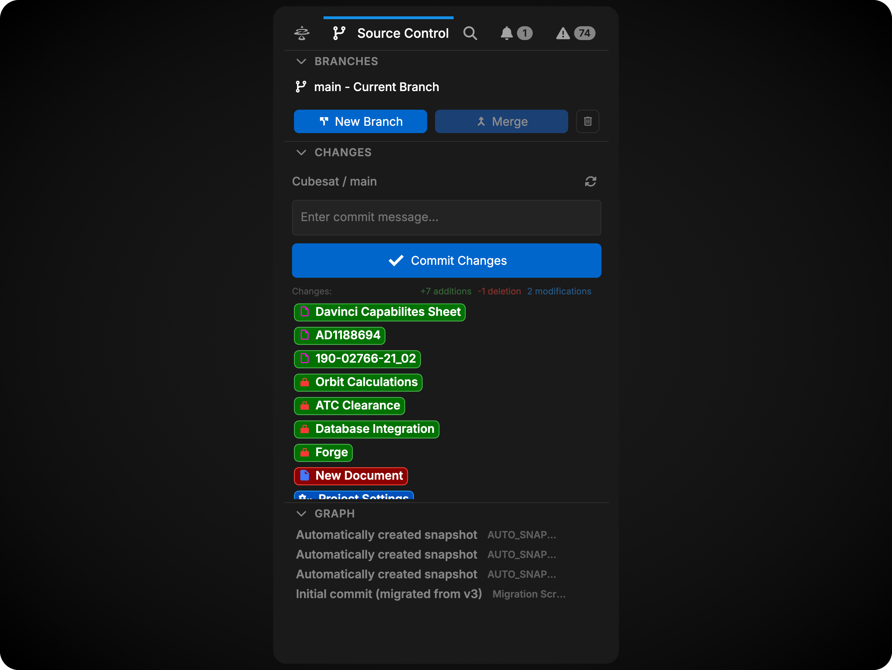
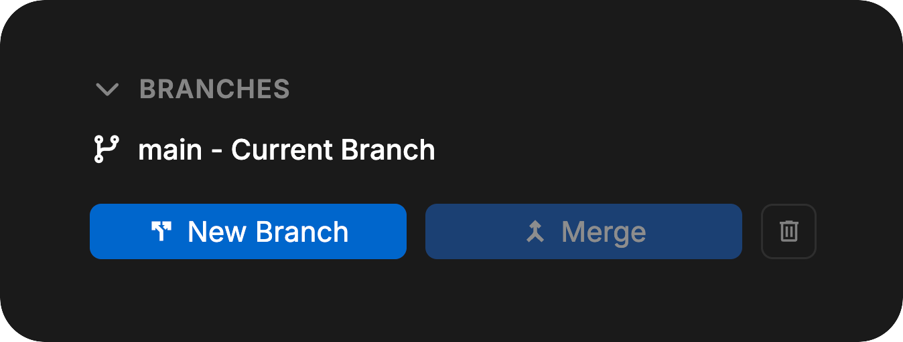
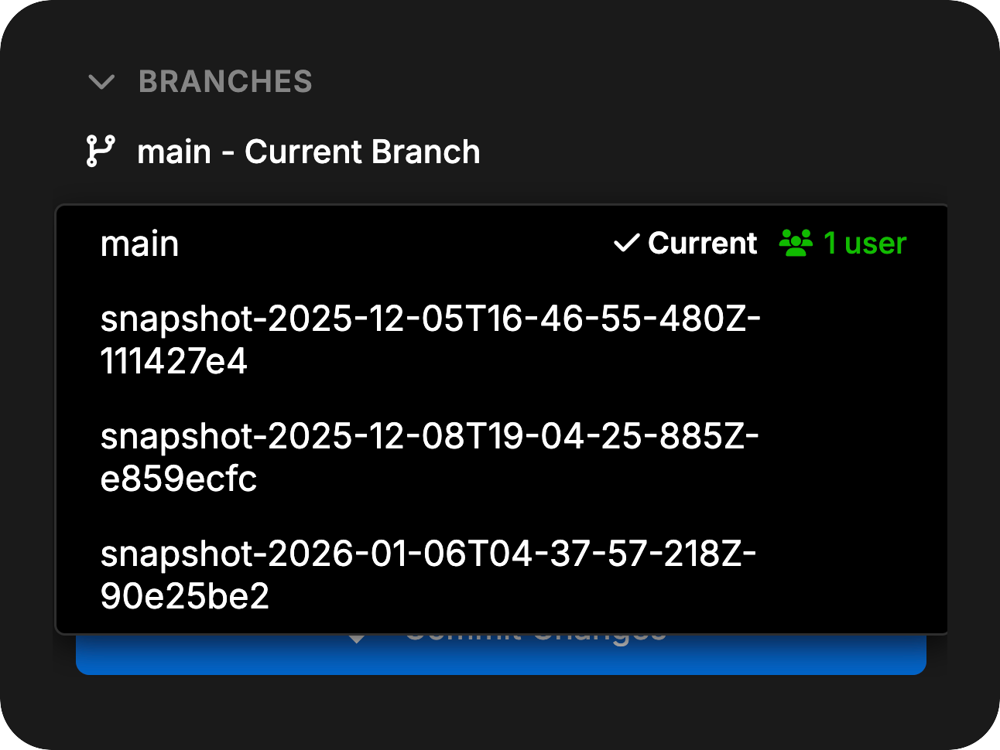
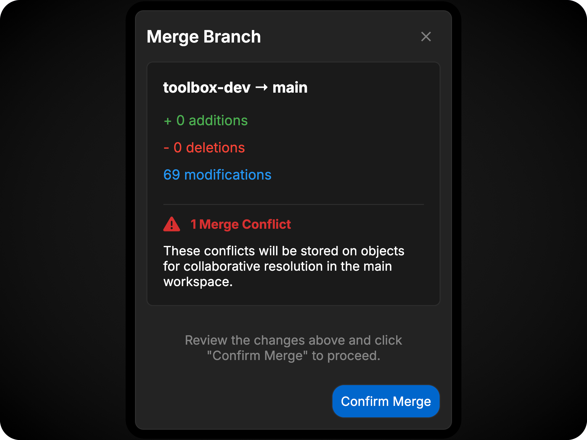
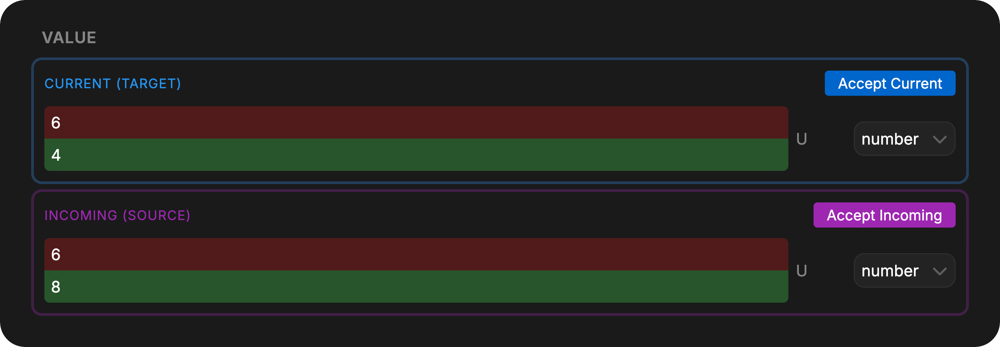
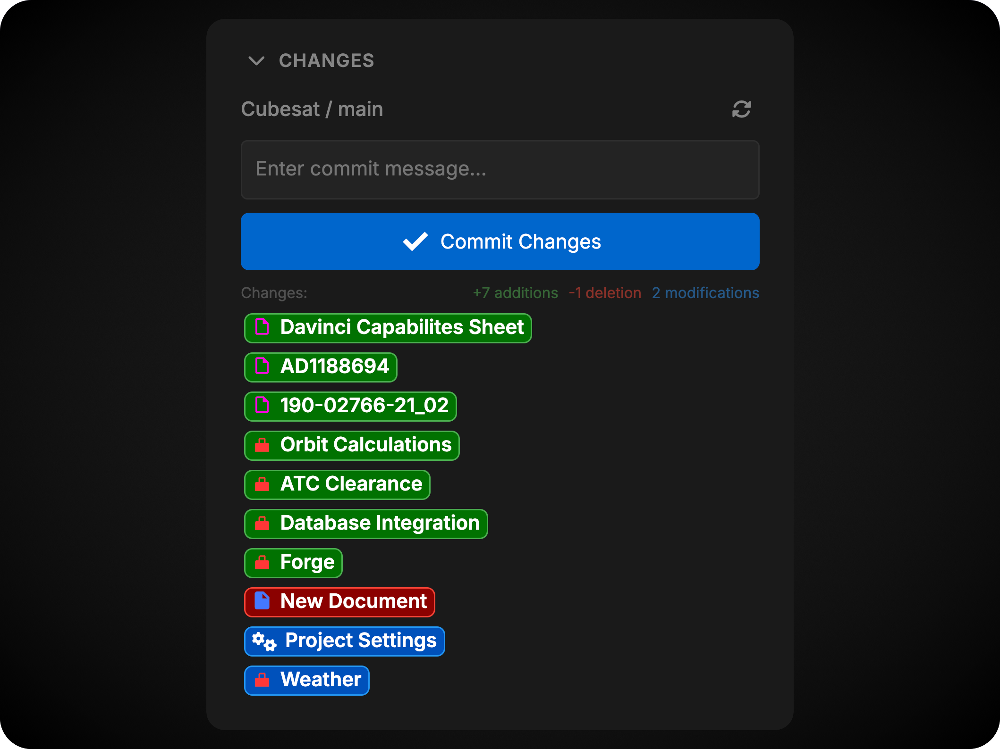
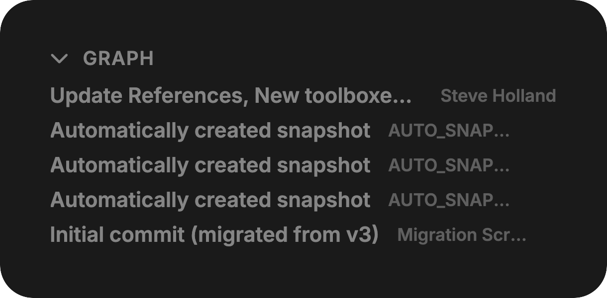
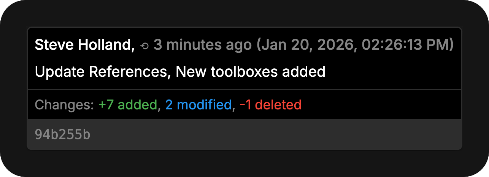
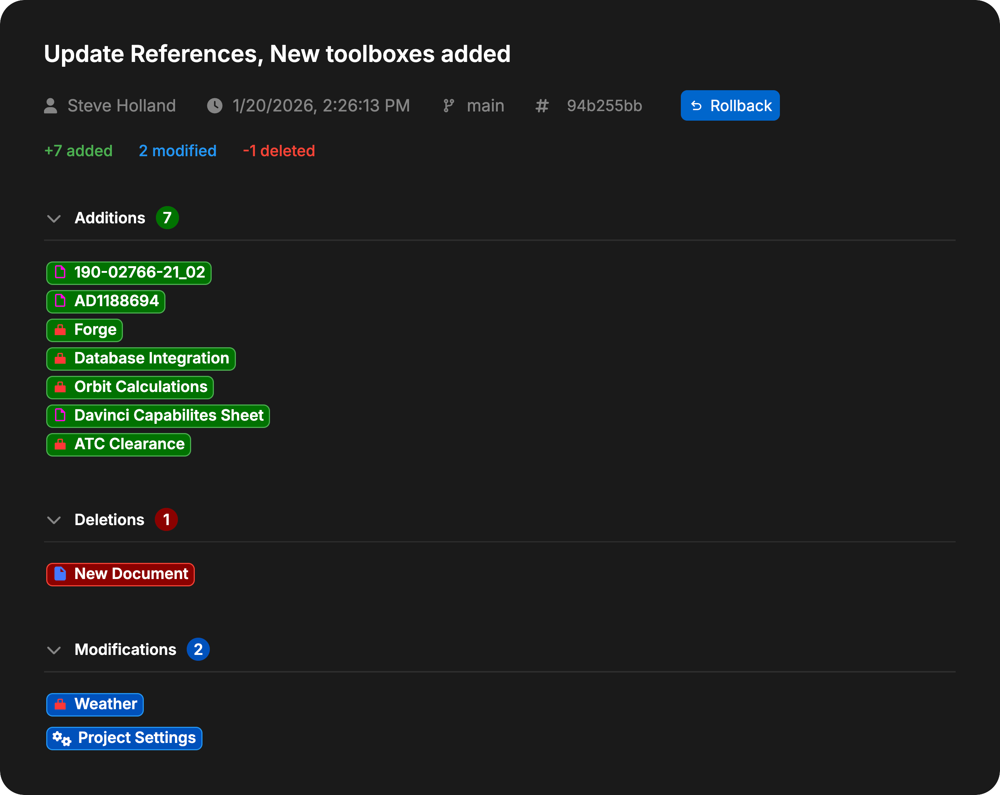

Source Control provides comprehensive project-wide version control management with support for branching, merging, committing changes, and viewing commit history. Version control in Davinci is multiplayer-enabled, allowing teams to collaborate effectively on the same model with full branch management capabilities.

<Frame>
    
</Frame>

## Branches

The Branches section allows you to manage all aspects of your project's branch structure. Version control in Davinci operates at the project level, meaning all changes and branches are shared across all collaborators.

<Frame>
    
</Frame>

### Creating Branches

New branches can be created from the current branch at any time. This allows you to experiment with changes or work on features in isolation without affecting the main branch.

### Switching Branches

You can switch between existing branches using the branch selector. When switching branches, any uncommitted changes will remain live in the previous branch and will be preserved when you return to that branch.

<Frame>
    
</Frame>

<Note>Uncommitted changes do not transfer between branches when switching. They remain in the branch where they were made.</Note>

### Merging Branches

To merge changes from one branch into another:

1. First, switch to the branch you want to merge **into** (the target branch)
2. Click the **Merge** button
3. Select the branch you want to merge **from** (the source branch)
4. Review the merge preview showing the number and types of changes that will be applied, along with any merge conflicts
5. Complete the merge
6. Resolve merge conflicts

<Frame>
    
</Frame>

<Warning>Direct merges cannot be performed when uncommitted changes or unresolved conflicts are present on the current branch. Commit or undo your changes before merging directly, or create a merge review request instead.</Warning>

#### Merge Reviews

When a merge needs review before it is applied, enable **Requires Review** in the merge dialog. A merge review records the source and target branches and pins the committed branch heads used for the review. Creating a merge review request is allowed even if you have uncommitted local changes, because it pins the committed branch heads without merging immediately.

To review a merge:

1. Switch to the target branch.
2. Open the merge request from the Source Control view.
3. Inspect the merge preview, including additions, modifications, deletions, and conflicts.
4. Approve the request, release an existing approval, close the request, or complete the merge according to your permissions.

An approval policy can allow anyone with edit access, project administrators only, or specifically named approvers to approve a request. Project Owners and Admins configure this policy under **Merge Approval** on the project's **Collaborators** tab in the Davinci Browser (see [Collaborators And Review Settings](/pages/browser/projects#collaborators-and-review-settings)). When open or approved merge requests are waiting and you have approval authority, the Source Control widget displays a purple count badge (or a split two-tone badge alongside your blue uncommitted changes count).

Merge reviews use the following states:

- **Open**: The request is waiting for review.
- **Approved**: An authorized reviewer approved the pinned merge.
- **Merged**: The approved changes were applied to the target branch.
- **Closed**: The request was closed without merging.
- **Stale**: One of the pinned branch heads changed, so the request must be reviewed again.

The request must be approved and completed from the target branch. If the source or target branch moves after the request is created, review the updated branch state and create a new request when necessary.

#### Merge Conflicts

Conflicts occur when the same object or field has been modified in different ways on both branches. You must select which version to keep or manually resolve the differences.

**Change-Change Conflicts**: The object was modified differently on both branches.

**Change-Delete Conflicts**: The object was changed on one branch and deleted on the other.

All other scenarios are automatically resolved by Davinci's merge logic.

#### Resolving Conflicts

All merge conflicts in the model can be viewed from [Validation](/pages/editor/widgets/validation) using the Merge Conflict filter.

Merge conflicts can be resolved cooperatively by any team member working in that branch. All users will see the same conflicts and can work together to resolve them.

When a conflict is resolved, it appears as a change in the Changes section. Commit the change to finalize the conflict resolution.

Changes marked `Current` are from the active branch. Changes marked `Incoming` are from the branch being merged.

<Frame>
    
</Frame>

<Note>Project-level settings (units, secrets, dependencies, tags, and risk configurations) are also tracked by version control. Conflicts for these objects are managed from [Project Settings](/pages/editor/project-settings/project).</Note>

### Deleting Branches

Branches can be deleted when they are no longer needed.

To delete a branch:
1. Select the trashcan icon in the Branch section
2. In the menu, select the branch you would like to delete
3. Select confirm
4. If you are currently in the branch to be deleted, you will be asked again to confirm

You cannot delete the main branch of the project.

## Changes

The Changes section displays all modifications made since the last commit on the current branch. This section shows changes from all users working on the current branch.

<Frame>
    
</Frame>

### View Current Changes

Click any object in the changes list to open a diff view showing exactly what has changed since the last commit.

The diff view highlights:
- **Added content** in green
- **Removed content** in red
- **Modified fields** with before/after comparisons

### Undoing Changes

Each object in the changes list has an **Undo** button that reverts all changes made to that object since the last commit.

<Warning>Some changes affect other objects through relationships and dependencies. Undoing one object may create additional changes in related objects.</Warning>

### Committing Changes

To commit your changes:

1. Review the list of modified objects
2. Enter a descriptive commit message
3. Click **Commit**

<Note>Commits require at least one change and a commit message. A commit happens only when someone asks for one: by clicking **Commit**, or by asking the Davinci Agent to commit.</Note>

Commits capture the current state of all changes and create a permanent record in project history.

### Subtree Commits

You can commit only a selected part of the model instead of committing every outstanding change on the branch. This workflow is sometimes called a **subtree commit** or **scoped commit**.

To create a scoped commit:

1. Review the objects listed in **Changes**.
2. Stage the objects that belong in the commit, or click **Stage All Changes** (`+`) when the whole change set is ready.
3. Enter a descriptive commit message.
4. Click **Commit Staged (N)** (or **Commit Changes** when committing all changes).

Davinci expands a staged selection when necessary to keep the model structurally valid. For example, a selection can include coupled relationship or equation changes, newly added ancestors, or descendants of deleted objects. The additional objects are part of the same scoped commit because they are required to represent the selected change correctly.

Staged changes use a snapshot of the selected objects. Changes that are not staged remain uncommitted on the branch after the commit and are reconciled with the new branch state. Staged selections are preserved across refreshes and device switches, and are rechecked when another commit, rollback, or merge changes the branch.

Use **Unstage All Changes** (`-`) to clear the staged list and return to an ordinary full-change commit. Staging does not discard or undo changes that are left outside the commit.

### Asking the Agent to Commit

You can ask the Davinci Agent to commit, for example: "Commit these changes with the message 'Add bracket requirements'". The agent checks the uncommitted changes, tells you what the commit will include, and commits them.

- The agent commits only when your request asks it to. Mentioning commits, such as asking about the last commit or asking for a commit message, is not enough.
- The commit is authored as you. In the Graph it shows **via Davinci Agent** beside your name, and its details say whether the message is your words or the agent's. Administrators can find agent commits in the audit log.
- You need permission to commit on the project, and the agent needs its Git write capability.
- The agent does not commit when there are no changes, when the branch has moved since it looked, when objects have unresolved merge conflicts, or while another commit is running.
- An agent commit stays in the project's history. Nothing is pushed, merged, published, or deployed.

## Graph

The Graph section displays the complete commit history for the current branch.

<Frame>
    
</Frame>

### View Commit Details

Each commit shows its message, author, and timestamp. Hover over a commit to see its full hash, exact date and time, and change statistics.

<Frame>
    
</Frame>

### Inspecting Commits

Click a commit to open its details in a workspace tab. From there you can inspect modified objects and open their diffs.

<Frame>
    
</Frame>

### Rolling Back

Use **Rollback** from a commit detail view to create a new commit that restores the project to that point. Intermediate history is preserved.

<Warning>Rolling back discards uncommitted changes on the current branch. Commit or undo work in progress first.</Warning>
