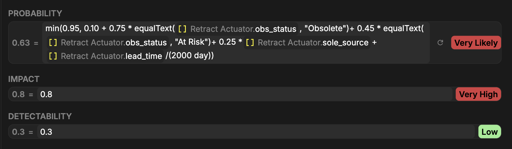

 

## Description
Risk objects represent potential uncertain events or conditions that, if they occur, have a positive or negative effect on one or more project objectives. In systems engineering, risks are typically characterized by their probability of occurrence and the impact they would have. Managing risks involves identifying, analyzing, and planning responses to these uncertainties to minimize negative outcomes and maximize opportunities.

Risks are quantified using three key metrics: probability (likelihood of occurrence), impact (severity of consequences), and detectability (how easily the risk can be identified before it occurs). The system automatically calculates the criticality (probability × impact) which shows up as resolved value element.

<Note>If the risk has owned sub-risks as children, then the parent risk will inherit the calculated values from its children based on the combinator logic and is not editable.</Note>

<Note>You can edit the risk categories of the project from the [Risk Categories](/pages/editor/project-settings/risk) tab in the project settings.</Note>

## Equation-Driven Metrics

Probability, impact, and detectability each accept either a number or an [equation](/pages/modeling/common/equations). Use an equation when a score should follow other model values instead of being entered by hand.

```text
0.3
[margin-attribute] / [margin-limit-attribute]
1 - [reliability-attribute]
[scoring-code].probability_of_failure([temperature-attribute], [cycles-attribute])
30%
```

An equation can use the same inputs as an attribute equation, including attribute references, Math.js functions, [Code object functions](/pages/modeling/common/equations#callable-code-functions), and [simulation Quantities of Interest](/pages/modeling/common/equations#simulation-quantities-of-interest). It cannot reference its own risk.

Every metric must resolve to a single unitless number between 0 and 1:

- Typed numbers outside 0–1 are rejected when you enter them.
- Percent results are converted to fractions, so `30%` resolves to `0.3`.
- Units that cancel, such as `[length-attribute] / [limit-attribute]` with compatible length units, reduce to a plain number.
- A result with a physical unit, a boolean, an array, or a value outside 0–1 shows an error on that metric. The metric keeps its last valid value until the equation is fixed.

In the Properties view, each metric row shows the resolved value, the equation or number you entered, and the matching risk category. For an equation-driven metric, select **Recalculate Value** to recompute it. The button is highlighted when the value may be out of date, for example after a referenced Code object changes.

<Frame>
    
</Frame>

Other equations can read a risk's resolved metrics with `[risk-uuid].probability`, `[risk-uuid].impact`, and `[risk-uuid].detectability`.

<Note>Equations apply only to leaf risks. A risk with sub-risks rolls up its metrics from its children and ignores its own entered values.</Note>

## View Types

| View | Description |
| :--- | :--- |
| [Properties](/pages/user-guide/views/properties) | Edit the object's properties, attributes, and metadata. |
| [Risk Analysis](#risk-analysis) | Analyze risks with probability and impact matrices. |
| [Table](/pages/user-guide/views/table) | Display the object and its children in a tabular format. |
| [Tree](/pages/user-guide/views/tree) | View the hierarchical structure of the object. |
| [Relationships](/pages/modeling/common/relationships) | Explore the network of connections to other objects. |
| [History](/pages/editor/model-area) | Track changes and revisions to the object. |

## Properties Fields

<ParamField path="Inheritable" type="boolean">
**Yes.** Risks can be used as bases or specializations through [object inheritance](/pages/modeling/common/inheritance).
</ParamField>


<ParamField path="Name" type="string">
Name of the object.
</ParamField>

<ParamField path="Short Name" type="string">
Short name of the object.
</ParamField>

<ParamField path="Documentation" type="string">
  Description of the object.
</ParamField>

<ParamField path="Probability" type="number | equation">
  The likelihood that the risk event will occur, expressed as a value between 0 and 1. Enter a number or an [equation](#equation-driven-metrics). This metric helps quantify uncertainty and is used to calculate expected loss.
</ParamField>

<ParamField path="Impact" type="number | equation">
  The magnitude of the effect if the risk occurs, representing the severity of consequences to project objectives. Enter a number between 0 and 1 or an [equation](#equation-driven-metrics). Combined with probability, this determines the overall risk exposure.
</ParamField>

<ParamField path="Detectability" type="number | equation">
  A measure of how easily the risk can be identified or detected before it materializes. Enter a number between 0 and 1 or an [equation](#equation-driven-metrics). Lower detectability increases the effective risk priority, as risks that are harder to detect pose greater danger.
</ParamField>

<ParamField path="Combinator" type="enum">
  Determines how sub-risk values are aggregated to calculate the parent risk's metrics. Options:
  - `OR`: Parent risk occurs if any sub-risk occurs (uses maximum values)
  - `AND`: Parent risk occurs only if all sub-risks occur (uses combined probabilities)
  
  This field only applies to risks with sub-risks and controls the inheritance logic.
</ParamField>


<ParamField path="Relationships" type="connection">

  A list of all Relationships this object has with other model objects.

  [Read more about Relationships](/pages/modeling/common/relationships)
</ParamField>

